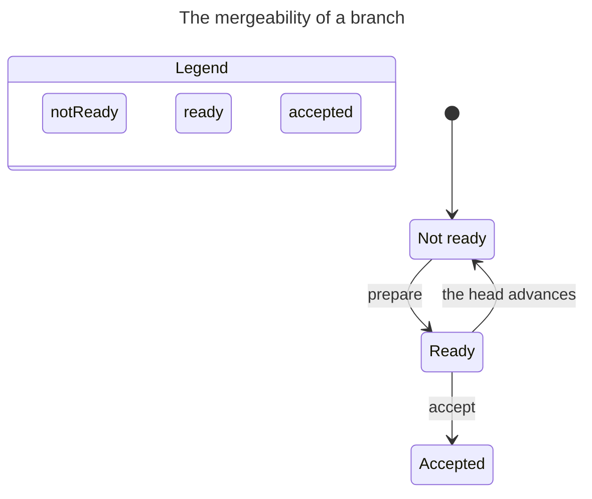

# The change flow: prepare, queue, accept

**Status:** open

## Context

The earlier chart was over the branch's work, with mergeability mixed into it. That is the wrong subject: the branch has its own lifecycle, and only a small part of it is the question the trunk asks -- can this branch be accepted now? The machine over that question has three states, and every one is a git predicate.

The "request" vocabulary came from a human review protocol: a pull or merge request exists so a person can read, approve and click. There is no reviewer here. One operator orders the work; one consumer accepts it. So the deliverable is a **prepared branch**, and the queue is an **order**.

## Decision

Three workflows:

- **Prepare** -- `prepare-rebase`: a worker rebases a branch onto the current head and resolves every conflict. The branch is **ready** when the head is a proper ancestor of its tip, so it fast-forwards.
- **Queue** -- `/merge-queue`: the operator orders the ready branches. A **stack** is a contiguous run in which each branch is prepared on the one before it.
- **Accept** -- `accept-fast-forward`: the consumer fast-forwards the trunk to the next ready branch. The head advances.

The queue is optional. A ready branch can go straight to `accept-fast-forward`, or through `/merge-queue` first to see the order. The graph has both edges; the queue is a view over the ready set, not a step every accept must pass.

The branch-work machine (`cut`, `working`, `blocked`, `parked`) is a separate machine. It is not mergeability.

The trunk has one state, **`stable`**. The head is a value. `accept` is an atomic transition back to `stable`, not a state named `accepting` or `advanced`.

## The chart



## The three states

| State | Predicate | Meaning |
|---|---|---|
| `not-ready` | the head is not an ancestor of the tip | it cannot be fast-forwarded |
| `ready` | the head is a proper ancestor of the tip | it fast-forwards |
| `accepted` | the tip is an ancestor of the head | it is on the trunk |

`stale` is not a state. It is the event "the head advanced" applied to a `ready` branch, which lands it back in `not-ready`. The worker may label that edge "re-prepare," but the mergeability value is `not-ready`.

The transitions are three: `not-ready -> ready` on prepare, `ready -> accepted` on accept, and `ready -> not-ready` when the head advances. `accepted` and `not-ready` are stable under a head advance.

Mergeability is derived, not stored. `ready` is `git merge-base --is-ancestor <head> <tip>`, `accepted` is the inverse, and `not-ready` is neither. The chart is a diagnostic over the repository, not a variable the system writes.

## The accept operation

`accept` is a guarded atomic transition, not a state:

- **Guard:** the branch is `ready` and it is at the head of the queue.
- **Stage:** verify it at the head in a scratch worktree: the suite and the lint gate.
- **Commit:** `update-ref refs/heads/trunk <tip> <head>` -- a compare-and-swap against the head that was checked.
- **Success:** the head becomes the tip.
- **Failure:** nothing is written; the head is unchanged.

`ready` makes the fast-forward total: a pointer move cannot fail for a semantic reason, because the branch resolved every conflict during prepare. The only remaining failures are environmental -- the head moved between the check and the CAS, a lock, an I/O error -- and the CAS catches exactly that.

This is the `make draft` / `make confirm` shape. Draft stages and verifies; confirm is the CAS. Verify before the CAS and there is nothing to roll back. Move first and verify after, and the rollback is the inverse CAS, which is why the old head is captured in the transaction.

The runbook does not need an `accepting` state, an `advanced` state, or a rollback state. It needs the guard, the stage and the CAS.

## The early-change workflow

A change is made available early when another branch needs it before the milestone's branch is complete. The change is a delivery commit like any other, cut onto its own branch.

1. **Prepare.** The worker rebases the change onto the head, resolves every conflict, and makes it fast-forwardable. The change is its own delivery commit on its own branch: the branch tip is the change's commit, with its own closed handover. The remainder is a child branch.
2. **Queue (optional).** `/merge-queue` orders it; the operator can also hand the ready branch straight to accept. The grain is which delivery commit is queued now: a slice cut onto its own branch, or the whole milestone's branch.
3. **Accept.** `/accept-fast-forward` CASes the head forward.
4. **Re-evaluate.** Every queued branch is re-checked. A branch no longer based on the head is `not-ready` and re-prepares.
5. **Continue.** The remainder is a child branch. It re-prepares onto the new head when the parent's prepare rewrote the shared base; when the parent was accepted without a rewrite, its tip already descends and it needs none.

A stack is a contiguous run. When the parent was accepted without a rewrite, the child's tip already descends from the new head, so its accept is a fast-forward and needs no re-prepare. When the parent's prepare rewrote the base, the child re-prepares.

## Critical workflow bugs

| Id | Bug | Carrier | Why it blocks | Status |
|---|---|---|---|---|
| W1 | The normal integration path is documented only as recovery. | `references/recovery.md`; `workflow_statechart.md`'s `recovery` region. | Prepare and accept are the normal path. The only entry says the work is lost. | Fixed: `recovery.md` and the `/recovery` skill. |
| W2 | The accept was a replay, not a fast-forward. | `accept-fast-forward.md`'s predecessor replayed. | The trunk authors the replay and resolves conflicts, so the CAS is impossible and the consumer is not atomic. | Fixed: `accept-fast-forward.md`. |
| W3 | The branch model says `main` is the only long-lived branch. | `references/branching.md`. | The long-lived track we work on has no stated lifetime, name or prepare obligation. | Fixed: `branching.md`'s branch tree. |
| W4 | Nothing obliges a branch to prepare when the head moves. | `references/branching.md`'s lifecycle. | A queued branch can become `not-ready` and no rule sends it back. | Fixed: `branching.md`'s prepare obligation and the change runbooks. |
| W5 | The early slice's delivery commit and handover shape is undefined. | `git-discipline`'s grouping and fold rules. | A `wip:` can land on the trunk, or the slice is a partial delivery commit with no handover. | Fixed: `git-discipline/SKILL.md`'s delivery commit and slice; one branch carries one delivery commit. |
| W6 | `/prepare-rebase` assumes every commit carries a handover. | `prepare-rebase.md`. | The post-slice remainder contains the split-out delivery commit, whose handover is not there to read. | Fixed: `prepare-rebase.md`'s one branch, one delivery commit. |

## What the model leaves out

The branch-work machine, the commit graph, the queue's order, the operator's grain reason, and the set of simultaneous branches. The mergeability value is derived in a real repository; the model stores it because TLC needs a variable. The model checks that the guard is structural: `accept` is enabled only from `ready`.

## Checked evidence

TLC reaches 11 states and 22 steps under `head <= 3`. The chart draws 3 states and 3 arrows. `TypeOK` and `NoDeadlock` hold. There is no forbidden path to mark, because the guard is the machine: an accept from `not-ready` is not a transition.

Reproduce with:

```sh
PATH="$HOME/.local/bin:$PATH" "$HOME/.pi/agent/skills/statechart/scripts/statechart" \
  Mergeability.tla --view view.mjs --out out
```

The output folder must be new or empty.

## Appendix: the model

```tla
---- MODULE Mergeability ----
EXTENDS Naturals, TLC

VARIABLES state, head

vars == <<state, head>>

TypeOK ==
  /\ state \in {"notReady", "ready", "accepted"}
  /\ head \in Nat

Init ==
  /\ state = "notReady"
  /\ head = 0

Prepare ==
  /\ state = "notReady"
  /\ state' = "ready"
  /\ UNCHANGED head

Accept ==
  /\ state = "ready"
  /\ state' = "accepted"
  /\ head' = head + 1

HeadAdvances ==
  /\ head' = head + 1
  /\ state' = IF state = "ready" THEN "notReady" ELSE state

Done ==
  /\ state \in {"accepted", "notReady"}
  /\ UNCHANGED vars

Next ==
  \/ Prepare \/ Accept \/ HeadAdvances \/ Done

Spec == Init /\ [][Next]_vars

StateConstraint == head <= 3

====
```

```js
export const state = (v) => {
  switch (v.state) {
    case "notReady":
      return "Not ready";
    case "ready":
      return "Ready";
    case "accepted":
      return "Accepted";
    default:
      return v.state;
  }
};

export const group = (v) => {
  if (v.state === "ready") return "ready";
  if (v.state === "accepted") return "accepted";
  return "notReady";
};

export const colors = {
  notReady: "orange",
  ready: "teal",
  accepted: "blue",
};

export const title = "The mergeability of a branch";

const steps = {
  Prepare: "prepare",
  Accept: "accept",
  HeadAdvances: "the head advances",
  Done: null,
};

export const step = (action, from, to) => {
  if (action === "HeadAdvances" && from.state === to.state) return null;
  return steps[action] ?? null;
};
```
