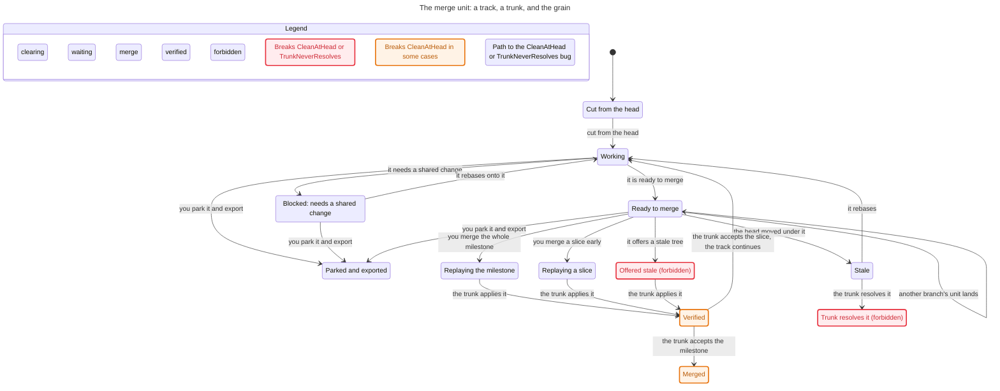

# The change flow: a track, a trunk, and the grain

**Status:** open

## Context

The feature flow is settled in its shape but not in its prose: a container works a branch, the branch replays into the trunk, and the trunk is fast-forwarded. Two corrections fixed the model. The author owns its merge-back: it may write any file, and it resolves its own conflicts; the integrator accepts a resolved tree, never an author or a resolver. And there is no second lane: the merge unit's grain is a judgement, so a small fix or contract change can travel down the same lane ahead of the milestone it would otherwise be bundled with.

This record writes the resulting statechart down, states the early-change-and-rebase rule, and lists the workflow bugs the model exposes.

## Decision

A change is a **merge unit**. Its grain is chosen by the operator or orchestrator at the merge gate: a whole milestone delivery, or a slice of it made available early. The rules do not vary with the grain.

- A branch is `ready` only when its tree applies to the current trunk head with no unresolved conflict (`CleanAtHead`).
- The integrator never edits a file to make a merge work, and never resolves a conflict on the author's behalf (`TrunkNeverResolves`).
- One unit is applied at a time.
- A live branch rebases when the trunk moves; a branch that cannot rebase cleanly stops and asks.
- The supplier of an early slice rebases afterwards, and its later milestone delivery drops the already-merged unit.

The defect flow is this model's `blocked` state expanded: a branch needs a semantic change to shared code or a shared contract, the change is authored once and merged as a unit, and the branch rebases. It is not a second model.

## The chart



## The early-change and rebase workflow

A change is made available early when another branch needs it before the author's milestone is complete. The unit is authored standalone from the start.

1. **Author it as its own unit.** The change is a typed commit (`fix:`, `refactor:` or `workflow:`), self-contained, with its own closed handover, applying at the current trunk head. It is not a `wip:` and not a fragment of a later iteration.
2. **Judge the grain.** The operator or orchestrator decides the unit is urgent enough to merge ahead of the milestone it would otherwise join. The judgement is criticality, not a special lane.
3. **Merge the unit.** The branch rebases onto the trunk head, resolves every conflict, and offers the tree. The trunk accepts it or rejects it; it does not edit it.
4. **Every live branch rebases.** The trunk head moved, so each open branch rebases before its next delivery. A branch that cannot resolve cleanly stops and asks.
5. **The supplier continues.** The author's branch rebases onto the new head; the already-merged unit drops, and the remaining milestone commits follow as their own unit.

The blocked branch is released at step 4. Until then it is `blocked`: it cannot author a second variant of a semantic change.

## Critical workflow bugs

The model exposes six defects in the current prose. Each is a carrier of the old "integration is recovery" framing or of a missing rule.

| Bug | Carrier | Why it blocks |
|---|---|---|
| The normal integration path is documented only as recovery. | `references/recovery.md` rows "Unlanded export" and "Unportable"; `workflow_statechart.md`'s `recovery` region; `git-discipline`'s runbook table, which calls merge "an export is corrupted or partial." | The early slice is a normal merge. The only entry to `/merge` says the work is lost, so an agent treats a live merge as a rescue. |
| `/merge` takes a draft export, not a live branch or a commit subset. | `merge.md`'s input contract ("a `draft/`-prefixed export") and "within a draft, keep the commit order." | The early slice is one commit on a feature branch. No input names it, so the operator must export the whole branch or hand-edit. |
| The branch model says `main` is the only long-lived branch. | `references/branching.md`, "Protected branches." | We work on `feat/M_3-orchestration`, a long-lived branch that is the merge target. The doc denies the topology in use: no lifetime, name or replay obligation. |
| Nothing obliges a live branch to rebase when the trunk moves. | `references/branching.md`'s lifecycle; `rebase.md`, which is invoked only when a branch is already stale. | The early slice lands and every other branch is based on an old head. `CleanAtHead` is unenforced. |
| The early slice's unit shape is undefined. | `git-discipline`'s grouping and fold rules; `merge.md`/`rebase.md` "one commit per iteration" and "each commit carries its handover." | An early slice lands before its iteration closes. As a `wip:` it puts a `wip:` on the trunk; as part of an iteration it is a partial unit with no handover. |
| `/rebase` assumes every commit carries a handover. | `rebase.md`, "read the handover of every stale iteration." | The supplier's post-slice delivery contains the split-out unit, whose handover is not there to read. |

## What the model leaves out

One track and one trunk. The multiple tracks are abstracted by `OtherLands`: any other branch's unit moves the head. The feature flow, the seam internals, the operator's triage reason and the set of simultaneous defects are outside. The grain is a judgement, not an invariant; the model checks the obligations that hold whatever grain is chosen.

## Checked evidence

TLC reaches 90 states and 170 steps under `head <= 3`. `CleanAtHead` breaks only on the path **Ready, then another unit lands, then it offers a stale tree**. `TrunkNeverResolves` breaks only on **Stale, then the trunk resolves it**. `TypeOK` and `NoDeadlock` hold, including the park/export route. The chart above is generated from the model.

The spec and its view are reproduced below so the chart can be rebuilt.

## Reproduce

```sh
PATH="$HOME/.local/bin:$PATH" "$HOME/.pi/agent/skills/statechart/scripts/statechart" \
  ParallelTracks.tla --view view.mjs --out out
```

The output folder must be new or empty. TLC exits 1 because the two forbidden rules break; that is the finding.

## Appendix: the model

```tla
---- MODULE ParallelTracks ----
EXTENDS Naturals, TLC

VARIABLES phase, base, head, grain, trunk, trunkResolved

vars == <<phase, base, head, grain, trunk, trunkResolved>>

TypeOK ==
  /\ phase \in {"cut", "working", "blocked", "ready", "stale",
                "replaying", "verified", "merged", "parked"}
  /\ base \in Nat
  /\ head \in Nat
  /\ grain \in {"none", "milestone", "slice"}
  /\ trunk \in {"idle", "replaying", "verifying"}
  /\ trunkResolved \in BOOLEAN

Init ==
  /\ phase = "cut"
  /\ base = 0
  /\ head = 0
  /\ grain = "none"
  /\ trunk = "idle"
  /\ trunkResolved = FALSE

Cut ==
  /\ phase = "cut"
  /\ phase' = "working"
  /\ base' = head
  /\ UNCHANGED <<head, grain, trunk, trunkResolved>>

Block ==
  /\ phase = "working"
  /\ phase' = "blocked"
  /\ UNCHANGED <<base, head, grain, trunk, trunkResolved>>

OtherLands ==
  /\ trunk = "idle"
  /\ head' = head + 1
  /\ UNCHANGED <<phase, base, grain, trunk, trunkResolved>>

Unblock ==
  /\ phase = "blocked"
  /\ base < head
  /\ phase' = "working"
  /\ base' = head
  /\ UNCHANGED <<head, grain, trunk, trunkResolved>>

Ready ==
  /\ phase = "working"
  /\ base = head
  /\ phase' = "ready"
  /\ UNCHANGED <<base, head, grain, trunk, trunkResolved>>

GoStale ==
  /\ phase = "ready"
  /\ base < head
  /\ phase' = "stale"
  /\ UNCHANGED <<base, head, grain, trunk, trunkResolved>>

Rebase ==
  /\ phase \in {"working", "stale"}
  /\ base < head
  /\ phase' = "working"
  /\ base' = head
  /\ UNCHANGED <<head, grain, trunk, trunkResolved>>

ChooseMilestone ==
  /\ trunk = "idle"
  /\ phase = "ready"
  /\ base = head
  /\ grain' = "milestone"
  /\ trunk' = "replaying"
  /\ phase' = "replaying"
  /\ UNCHANGED <<base, head, trunkResolved>>

ChooseSlice ==
  /\ trunk = "idle"
  /\ phase = "ready"
  /\ base = head
  /\ grain' = "slice"
  /\ trunk' = "replaying"
  /\ phase' = "replaying"
  /\ UNCHANGED <<base, head, trunkResolved>>

Apply ==
  /\ trunk = "replaying"
  /\ phase = "replaying"
  /\ trunk' = "verifying"
  /\ phase' = "verified"
  /\ UNCHANGED <<base, head, grain, trunkResolved>>

AcceptMilestone ==
  /\ trunk = "verifying"
  /\ phase = "verified"
  /\ grain = "milestone"
  /\ head' = head + 1
  /\ base' = head + 1
  /\ trunk' = "idle"
  /\ grain' = "none"
  /\ phase' = "merged"
  /\ UNCHANGED trunkResolved

AcceptSlice ==
  /\ trunk = "verifying"
  /\ phase = "verified"
  /\ grain = "slice"
  /\ head' = head + 1
  /\ base' = head + 1
  /\ trunk' = "idle"
  /\ grain' = "none"
  /\ phase' = "working"
  /\ UNCHANGED trunkResolved

Park ==
  /\ phase \in {"working", "blocked", "ready"}
  /\ phase' = "parked"
  /\ UNCHANGED <<base, head, grain, trunk, trunkResolved>>

Done ==
  /\ phase \in {"merged", "parked"} \/ trunkResolved
  /\ UNCHANGED vars

OfferStale ==
  /\ trunk = "idle"
  /\ phase = "ready"
  /\ base < head
  /\ trunk' = "replaying"
  /\ phase' = "replaying"
  /\ grain' = "slice"
  /\ UNCHANGED <<base, head, trunkResolved>>

TrunkResolve ==
  /\ trunk = "idle"
  /\ phase = "stale"
  /\ trunk' = "verifying"
  /\ phase' = "verified"
  /\ trunkResolved' = TRUE
  /\ UNCHANGED <<base, head, grain>>

Next ==
  \/ Cut \/ Block \/ OtherLands \/ Unblock \/ Ready \/ GoStale \/ Rebase
  \/ ChooseMilestone \/ ChooseSlice \/ Apply \/ AcceptMilestone \/ AcceptSlice \/ Park \/ Done
  \/ OfferStale \/ TrunkResolve

Spec == Init /\ [][Next]_vars

CleanAtHead == phase \in {"replaying", "verified", "merged"} => base = head

TrunkNeverResolves == trunkResolved = FALSE

StateConstraint == head <= 3

====
```

```js
const label = (v) => {
  if (v.trunkResolved) return "Trunk resolves it (forbidden)";
  if (v.phase === "replaying" && v.base < v.head) return "Offered stale (forbidden)";
  switch (v.phase) {
    case "cut": return "Cut from the head";
    case "working": return "Working";
    case "blocked": return "Blocked: needs a shared change";
    case "ready": return "Ready to merge";
    case "stale": return "Stale";
    case "replaying":
      return v.grain === "milestone" ? "Replaying the milestone" : "Replaying a slice";
    case "verified": return "Verified";
    case "merged": return "Merged";
    case "parked": return "Parked and exported";
    default: return v.phase;
  }
};

export const state = label;

export const group = (v) => {
  if (v.trunkResolved) return "forbidden";
  if (v.phase === "replaying" && v.base < v.head) return "forbidden";
  if (v.phase === "replaying") return "merge";
  if (v.phase === "verified") return "verified";
  if (["blocked", "ready", "stale"].includes(v.phase)) return "waiting";
  return "clearing";
};

export const colors = {
  clearing: "blue",
  waiting: "orange",
  merge: "purple",
  verified: "teal",
  forbidden: "pink",
};

export const title = "The merge unit: a track, a trunk, and the grain";

const steps = {
  Cut: "cut from the head",
  Block: "it needs a shared change",
  OtherLands: "another branch's unit lands",
  Unblock: "it rebases onto it",
  Ready: "it is ready to merge",
  GoStale: "the head moved under it",
  Rebase: "it rebases",
  ChooseMilestone: "you merge the whole milestone",
  ChooseSlice: "you merge a slice early",
  Apply: "the trunk applies it",
  AcceptMilestone: "the trunk accepts the milestone",
  AcceptSlice: "the trunk accepts the slice, the track continues",
  Park: "you park it and export",
  OfferStale: "it offers a stale tree",
  TrunkResolve: "the trunk resolves it",
  Done: null,
};

export const step = (action) => steps[action] ?? null;
```
