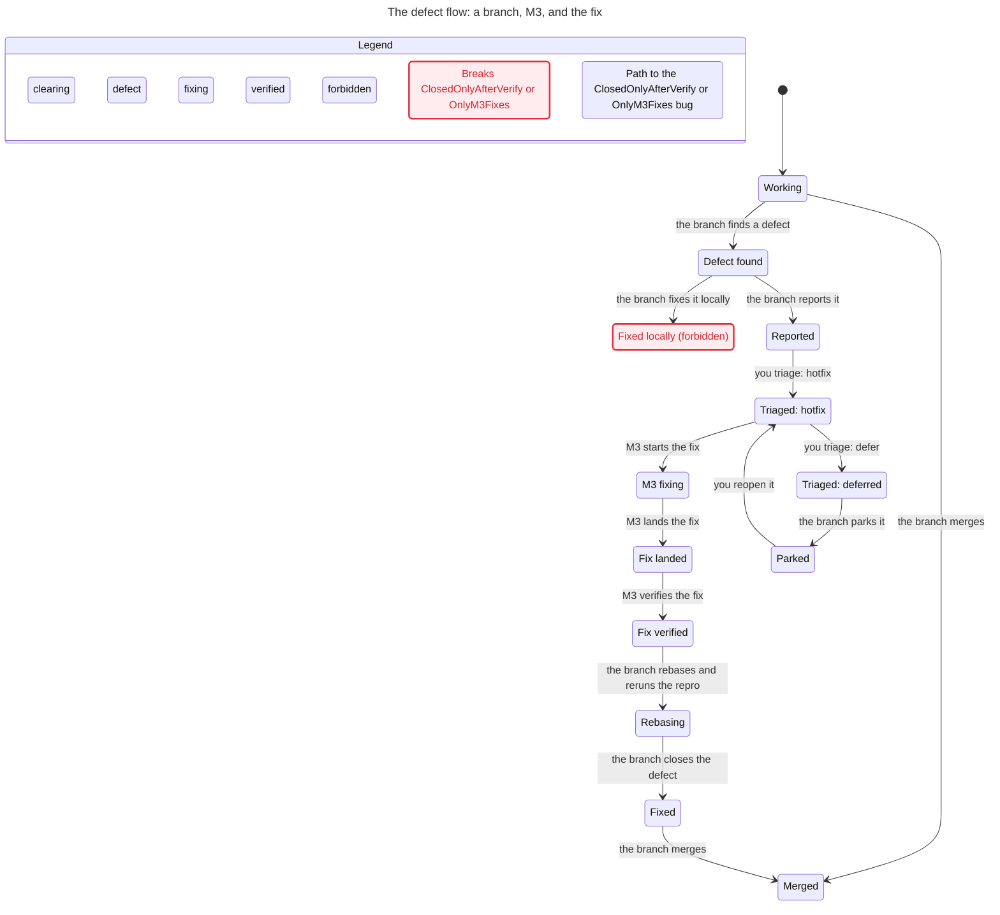

# The defect flow across a branch and M3

**Status:** open

## Context

The feature flow is settled: the operator branches out, a container works, the branch replays into M3, and M3 is fast-forwarded by a restart. The defect flow is not. A branch that finds a bug in M3's shared code can fix it locally, report it, wait, or file it; nothing says which, who owns the fix, or what stops two branches from carrying two variants. This record is the statechart of the proposed answer, built with the pstack `statechart` skill: a TLA+ model checked by TLC, the shortest path to each broken rule, and a Mermaid chart.

## Decision

A defect in M3's code is fixed on M3 once, by whoever holds M3, and reaches branches by replay. A branch reports the defect in its handover and may attach a patch as evidence, but it never merges the fix itself. M3 verifies the fix with the suite and the gate; the reporting branch rebases onto the fix and reruns its reproduction. Two signatures close the defect. A branch that cannot take the M3 head cherry-picks the single fix commit. A deferred defect is parked and reopened rather than fixed in the branch. Two branches that need different seam features are not independent: fix at the shared layer, or serialize them.

## The chart



## What TLC found

Both `OnlyM3Fixes` and `ClosedOnlyAfterVerify` break on the same two-step path: **Working, then the branch finds a defect, then the branch fixes it locally, ending at Fixed locally (forbidden).** The chart marks that state `breaks` and the path `bugPath`. `NoDeadlock` holds, including the deferred route through `Parked`.

The two rules are:

- `OnlyM3Fixes`: a branch carries a fix only when M3 has one (`variant = FALSE`).
- `ClosedOnlyAfterVerify`: a branch is fixed only after M3's fix is verified.

## The model

The spec, the config and the view are reproduced here so the chart can be rebuilt without this session.

```tla
---- MODULE DefectFlow ----
EXTENDS Naturals, TLC

VARIABLES branchState, m3State, fixOnM3, variant

vars == <<branchState, m3State, fixOnM3, variant>>

TypeOK ==
  /\ branchState \in {"working", "observed", "reported", "waiting",
                      "propagating", "fixed", "merged"}
  /\ m3State \in {"idle", "triaging", "fixing", "landed", "verified", "deferred"}
  /\ fixOnM3 \in BOOLEAN
  /\ variant \in BOOLEAN

Init ==
  /\ branchState = "working"
  /\ m3State = "idle"
  /\ fixOnM3 = FALSE
  /\ variant = FALSE

Observe ==
  /\ branchState = "working"
  /\ branchState' = "observed"
  /\ UNCHANGED <<m3State, fixOnM3, variant>>

Report ==
  /\ branchState = "observed"
  /\ branchState' = "reported"
  /\ UNCHANGED <<m3State, fixOnM3, variant>>

\* The tempting shortcut the rule forbids.
FixLocally ==
  /\ branchState = "observed"
  /\ branchState' = "fixed"
  /\ variant' = TRUE
  /\ UNCHANGED <<m3State, fixOnM3>>

Triage ==
  /\ m3State = "idle"
  /\ branchState = "reported"
  /\ m3State' = "triaging"
  /\ UNCHANGED <<branchState, fixOnM3, variant>>

Defer ==
  /\ m3State = "triaging"
  /\ m3State' = "deferred"
  /\ UNCHANGED <<branchState, fixOnM3, variant>>

StartFix ==
  /\ m3State = "triaging"
  /\ m3State' = "fixing"
  /\ UNCHANGED <<branchState, fixOnM3, variant>>

LandFix ==
  /\ m3State = "fixing"
  /\ m3State' = "landed"
  /\ fixOnM3' = TRUE
  /\ UNCHANGED <<branchState, variant>>

VerifyM3 ==
  /\ m3State = "landed"
  /\ m3State' = "verified"
  /\ UNCHANGED <<branchState, fixOnM3, variant>>

VerifyRepro ==
  /\ m3State = "verified"
  /\ branchState = "reported"
  /\ branchState' = "propagating"
  /\ UNCHANGED <<m3State, fixOnM3, variant>>

Close ==
  /\ branchState = "propagating"
  /\ branchState' = "fixed"
  /\ UNCHANGED <<m3State, fixOnM3, variant>>

Park ==
  /\ m3State = "deferred"
  /\ branchState = "reported"
  /\ branchState' = "waiting"
  /\ UNCHANGED <<m3State, fixOnM3, variant>>

Reopen ==
  /\ m3State = "deferred"
  /\ branchState = "waiting"
  /\ branchState' = "reported"
  /\ m3State' = "triaging"
  /\ UNCHANGED <<fixOnM3, variant>>

Merge ==
  /\ branchState \in {"working", "fixed"}
  /\ branchState' = "merged"
  /\ UNCHANGED <<m3State, fixOnM3, variant>>

Done ==
  /\ branchState \in {"merged", "fixed"}
  /\ UNCHANGED vars

Next ==
  \/ Observe \/ Report \/ FixLocally \/ Triage \/ Defer \/ StartFix
  \/ LandFix \/ VerifyM3 \/ VerifyRepro \/ Close \/ Park \/ Reopen
  \/ Merge \/ Done

Spec == Init /\ [][Next]_vars

\* A fix reaches a branch only after it lands on M3.
OnlyM3Fixes == variant = FALSE

\* A branch is fixed only after M3's fix is verified.
ClosedOnlyAfterVerify == branchState = "fixed" => m3State = "verified"

====
```

```cfg
SPECIFICATION Spec
INVARIANTS OnlyM3Fixes ClosedOnlyAfterVerify
```

```js
const branch = (v) => {
  if (v.variant) return "Fixed locally (forbidden)";
  switch (v.branchState) {
    case "working":
      return "Working";
    case "observed":
      return "Defect found";
    case "reported":
      if (v.m3State === "idle") return "Reported";
      if (v.m3State === "triaging") return "Triaged: hotfix";
      if (v.m3State === "deferred") return "Triaged: deferred";
      if (v.m3State === "fixing") return "M3 fixing";
      if (v.m3State === "landed") return "Fix landed";
      if (v.m3State === "verified") return "Fix verified";
      return "Reported";
    case "waiting":
      return "Parked";
    case "propagating":
      return "Rebasing";
    case "fixed":
      return "Fixed";
    case "merged":
      return "Merged";
    default:
      return v.branchState;
  }
};

export const state = (v) => branch(v);

export const group = (v) => {
  if (v.variant) return "forbidden";
  if (v.branchState === "reported" && ["triaging", "fixing", "landed"].includes(v.m3State))
    return "fixing";
  if (v.branchState === "reported" && v.m3State === "verified") return "verified";
  if (v.branchState === "working" || v.branchState === "merged") return "clearing";
  if (["observed", "reported", "waiting"].includes(v.branchState)) return "defect";
  return "verified";
};

export const colors = {
  clearing: "blue",
  defect: "orange",
  fixing: "purple",
  verified: "teal",
  forbidden: "pink",
};

export const title = "The defect flow: a branch, M3, and the fix";

const steps = {
  Observe: "the branch finds a defect",
  Report: "the branch reports it",
  FixLocally: "the branch fixes it locally",
  Triage: "you triage: hotfix",
  Defer: "you triage: defer",
  StartFix: "M3 starts the fix",
  LandFix: "M3 lands the fix",
  VerifyM3: "M3 verifies the fix",
  VerifyRepro: "the branch rebases and reruns the repro",
  Close: "the branch closes the defect",
  Park: "the branch parks it",
  Reopen: "you reopen it",
  Merge: "the branch merges",
  Done: null,
};

export const step = (action) => steps[action] ?? null;
```

## What the model leaves out

One reporting branch and one defect. The feature flow, the seam internals, the operator's triage decision, and the set of simultaneous defects are outside. The two-branch variant case is represented by `OnlyM3Fixes`, not by a second branch in the model.

## Reproduce

Install the pstack `statechart` skill and `mise`, then run:

```sh
PATH="$HOME/.local/bin:$PATH" "$HOME/.pi/agent/skills/statechart/scripts/statechart" \
  DefectFlow.tla --view view.mjs --out out
```

The output folder must be new or empty. TLC exits 1 because the two rules break; that is the finding, not a failure of the run.
