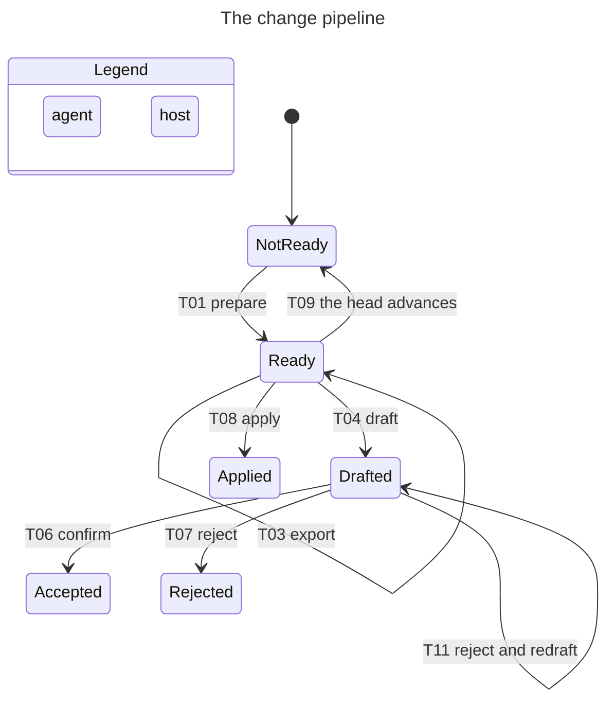

# The change model

The change model answers one question: can the trunk accept this branch now? It is not the branch's own lifecycle -- `cut`, `working`, `blocked` and `parked` are a separate machine, `.agents/skills/git-discipline/references/branching.md`. It is not the draft's lifecycle -- the draft's states are `draft_branch_statechart.md`'s. It is a relation between the trunk head and the branch tip, and every mergeability value is a git predicate.

The work happens in two lanes. The agent lane prepares and exports; the host lane drafts, reviews, confirms or rejects, or applies. The lanes are parallel and meet at one handoff: the bundle and the draft worktree. The host lane never reads the agent's workspace, and the agent lane never writes the trunk.

## The two lanes

| Lane | Actor | Entry | Work | Exit |
|---|---|---|---|---|
| Agent | the coding agent | the workspace: copy (a volume seeded at start) or mount (the host worktree); full or flatten history | branch work, prepare, history-cleanup, export | the bundle and its branch point |
| Host | the operator | the bundle and the draft worktree | draft, review, confirm or reject, or apply | the trunk advanced, or the bundle rejected or applied |

The export -> draft (or export -> apply) handoff is the only meeting point.

## The delivery parameter

Delivery is a parameter of the agent lane's entry, not a second pipeline. Copy delivery seeds a volume at the session start; the host's later changes are invisible. Mount delivery materialises the host worktree; the host's changes are visible during the session. History is the second axis: full by default, flatten by opt-out. The diff pipeline is the same for both deliveries and both history modes: the bundle is the correspondence, the branch point is recorded, the host verbs are the same, no git crosses the boundary, and the apply commands carry no delivery awareness.

The delivery changes the entry and the visibility assertions, not the handoff. Copy freezes the view and keeps the session isolated; mount exposes host changes and carries the higher exposure posture. The test matrix runs the same transitions for copy and mount, full and flatten.

## The three states

| State | Predicate | Meaning |
|---|---|---|
| `not-ready` | the head is not an ancestor of the tip | it cannot be fast-forwarded |
| `ready` | the head is a proper ancestor of the tip | it fast-forwards |
| `accepted` | the tip is an ancestor of the head | it is on the trunk |

`stale` is not a state. It is the event "the head advanced" applied to a `ready` branch, which lands it back in `not-ready`. A worker may call the edge "re-prepare"; the mergeability value is `not-ready`.

The host lane adds the handoff states `drafted`, `rejected` and `applied`; they say a draft or an applied bundle exists, not that the branch's mergeability has changed. The draft's internal states are the draft chart's.

## The transitions

The transition table is the contract; the chart below is its rendered view. `Lane` and `Actor` say who acts, `Mechanism` names the command or git operation, and `Manual` says whether an operator decision is part of the step. A blocked path is a transition that does not fire, recorded in `## The blocked paths`.

| Id | Lane | Actor | Event | Guard | From | To | Mechanism | Manual | Subject | Invariant | Test | Mutation |
|---|---|---|---|---|---|---|---|---|---|---|---|---|
| `T01` | agent | agent | prepare | the head is not an ancestor of the tip | `not-ready` | `ready` | rebase onto the head | no | the prepare runbook | `PrepareResolvesEveryConflict` | `none: model check` | `none: model-only` |
| `T02` | agent | agent | history-cleanup | the series is not reviewable | `ready` | `ready` | `history-cleanup` | no | the history-cleanup skill | `SeriesIsReviewable` | `none: model check` | `none: model-only` |
| `T03` | agent | agent | export | the branch is prepared | `ready` | `ready` | the package step | no | the export step | `BundleCarriesTheBranchPoint` | `none: model check` | `none: model-only` |
| `T04` | host | operator | draft | a bundle is present | `ready` | `drafted` | `make draft` | no | `scripts/workflows/draft.sh` | `MergeableRequiresForkable` | `test_draft_forks_from_branch_point_not_head` | `252` |
| `T05` | host | operator | review | a draft is present | `drafted` | `drafted` | read the diff | yes | none: operator action | `ReviewBeforeAccept` | `none: operator action` | `none: operator action` |
| `T06` | host | operator | confirm | the draft is ready and at the queue head | `drafted` | `accepted` | `make confirm` | yes | `scripts/workflows/confirm.sh` | `AtomicAccept` | `test_confirm_script_entry_merges_draft` | `52` |
| `T07` | host | operator | reject | a draft is present | `drafted` | `rejected` | `make reject` | yes | `scripts/workflows/reject.sh` | `RejectRestoresTheSource` | `test_reject_returns_to_source` | `259` |
| `T08` | host | operator | apply | a bundle is present and no draft is wanted | `ready` | `applied` | `make apply` | yes | `scripts/workflows/apply.sh` | `ApplyIsDirect` | `test_apply_run_single_file_diff_reports_one` | `none: model-only` |
| `T09` | host | another accept | the head advances | a confirm moved the head | `ready` | `not-ready` | the trunk ref update | no | none: model-only | `ReadyReturnsToNotReady` | `none: model check` | `none: model-only` |
| `T10` | host | operator | operator git | the operator runs git outside the verbs | `drafted` | `drafted` | raw git | yes | none: operator action | `OperatorGitRederivesTheState` | `none: operator action` | `none: operator action` |
| `T11` | host | operator | reject and redraft | the draft is inconsistent | `drafted` | `drafted` | `make reject` then `make draft` | yes | `scripts/workflows/reject.sh` | `MistakeHasARemediation` | `test_reject_returns_to_source` | `259` |

## The chart

<!-- snippet: illustrative -->


## The blocked paths

| Event | Blocked when | What happens |
|---|---|---|
| prepare | the branch is already `ready` | it is a no-op; the branch is fast-forwardable |
| confirm | the branch is `not-ready` | it is not a transition; the branch re-prepares |
| confirm | the branch is not at the queue head | it waits; the head advances and the branch re-checks |
| reject | no draft exists | there is nothing to reject; the branch is unchanged |
| operator git | no draft exists | only the branch moves; the mergeability re-derives |
| reject and redraft | the bundle is missing or malformed | the redraft refuses; the bundle is repaired first |

## The primitives

The agent lane's primitives are prepare, history-cleanup and export. The host lane's verbs are `make draft`, `make confirm`, `make reject` and `make apply`; `NEW=1` and `FORCE=1` deepen `confirm`. The queue is the host's order over the ready set, not a verb.

| Primitive | Lane | Command | What it does |
|---|---|---|---|
| Prepare | agent | the prepare runbook | rebases onto the head, resolves every conflict, makes it fast-forwardable |
| History-cleanup | agent | `history-cleanup` | makes the series reviewable before export |
| Export | agent | the package step | writes the bundle and its branch point |
| Draft | host | `make draft` | creates the draft worktree from the bundle |
| Confirm | host | `make confirm` | stages and verifies, then compare-and-swaps the trunk |
| Reject | host | `make reject` | discards the draft and restores the source |
| Apply | host | `make apply` | applies the bundle directly, without a draft |

## The accept operation

Accept is a guarded atomic transition, not a state. The guard is that the branch is `ready` and at the head of the queue. The trunk advances by `update-ref refs/heads/<trunk> <tip> <head>`, a compare-and-swap against the head the staged tree was verified at. If the CAS loses, nothing is written and the head is unchanged. `ready` makes the fast-forward total: the branch resolved every conflict during prepare, so the only failures left are environmental. The staging and verification steps are `make confirm`'s; this section states the contract.

## The host lane's git

The host lane's actor is the operator, who may run git outside the verbs. The model does not assume the operator is careful; it assumes the verbs are the safe path and states what to do when a raw operation goes wrong.

A competent operation is indistinguishable from a verb's mechanism: the next verb re-reads the state, and the branch's mergeability re-derives. A raw `git reset` on the branch can make it `not-ready`; the next prepare fixes it.

A mistaken operation leaves the draft inconsistent: a wrong checkout, uncommitted edits, a half-applied bundle. The remediation is `make reject`, which discards the draft and restores the source, then `make draft`, which rebuilds the draft from the bundle. The bundle is unchanged; the branch is unchanged; only the draft is replaced. This is the host flow's repair, not the recovery of a unit's claim and not a new verb.

## The branch work is separate

The branch has its own lifecycle: it is cut, worked, blocked or parked, and it is deleted when its trunk accepts it. That machine is not mergeability. The trunk asks only whether the branch is `ready`, and a branch that is `working` is simply not ready yet. The branch tree, its tracks and its prepare obligation are `.agents/skills/git-discipline/references/branching.md`. The unified fork-to-deletion lifecycle is the model's destination, recorded as a roadmap task; this split is the interim.

## The early change

A change is made available early when another branch needs it before the milestone's branch is complete. The change is its own delivery commit on its own branch, with its own closed handover; the remainder is a child branch. The operator chooses the grain -- a slice cut onto its own branch, or the whole milestone's branch -- and the queue orders it. The steps are the `prepare` runbook, the host's order and `make confirm`. When the head moves, every queued branch is re-checked: a branch no longer based on the head is `not-ready` and re-prepares.

A stack is a contiguous run. When the parent was accepted without a rewrite, the child's tip already descends from the new head, so its accept is a fast-forward and needs no re-prepare. When the parent's prepare rewrote the base, the child re-prepares.

## The defect flow

The defect flow is the change flow applied to a fix that more than one branch needs. A defect is reported in a handover's Findings, the operator triages it, and the fix lands once on the trunk lane as a delivery commit. Every other branch is `not-ready` against the fix until it is accepted; then each re-prepares onto the new head and replays the fix rather than writing a variant. The model is `20261105-design-open-defect_flow.md`; this section states only its relation to the change flow.

## The check

TLC checks the appendix with the `statechart` skill's runner; run it to reproduce the state and step counts. `scripts/check_change_model.sh` holds the table to the chart and to the mutation catalog.

## Appendix: the model

<!-- snippet: illustrative -->
```tla
---- MODULE ChangeModel ----
EXTENDS Naturals, TLC

VARIABLES state, head, lane

vars == <<state, head, lane>>

TypeOK ==
  /\ state \in {"notReady", "ready", "drafted", "accepted", "rejected", "applied"}
  /\ head \in Nat
  /\ lane \in {"agent", "host"}

Init ==
  /\ state = "notReady"
  /\ head = 0
  /\ lane = "agent"

Prepare ==
  /\ state = "notReady"
  /\ state' = "ready"
  /\ lane' = "agent"
  /\ UNCHANGED head

Draft ==
  /\ state = "ready"
  /\ state' = "drafted"
  /\ lane' = "host"
  /\ UNCHANGED head

Confirm ==
  /\ state = "drafted"
  /\ state' = "accepted"
  /\ head' = head + 1
  /\ lane' = "host"

Reject ==
  /\ state = "drafted"
  /\ state' = "rejected"
  /\ lane' = "host"
  /\ UNCHANGED head

Apply ==
  /\ state = "ready"
  /\ state' = "applied"
  /\ lane' = "host"
  /\ UNCHANGED head

HeadAdvances ==
  /\ state = "ready"
  /\ head' = head + 1
  /\ state' = "notReady"
  /\ lane' = "host"

OperatorGit ==
  /\ state = "drafted"
  /\ state' = "drafted"
  /\ lane' = "host"
  /\ UNCHANGED head

RejectAndRedraft ==
  /\ state = "drafted"
  /\ state' = "drafted"
  /\ lane' = "host"
  /\ UNCHANGED head

Done ==
  /\ state \in {"accepted", "rejected", "applied"}
  /\ UNCHANGED vars

Next ==
  \/ Prepare \/ Draft \/ Confirm \/ Reject \/ Apply
  \/ HeadAdvances \/ OperatorGit \/ RejectAndRedraft \/ Done

Spec == Init /\ [][Next]_vars

StateConstraint == head <= 3

====
```
