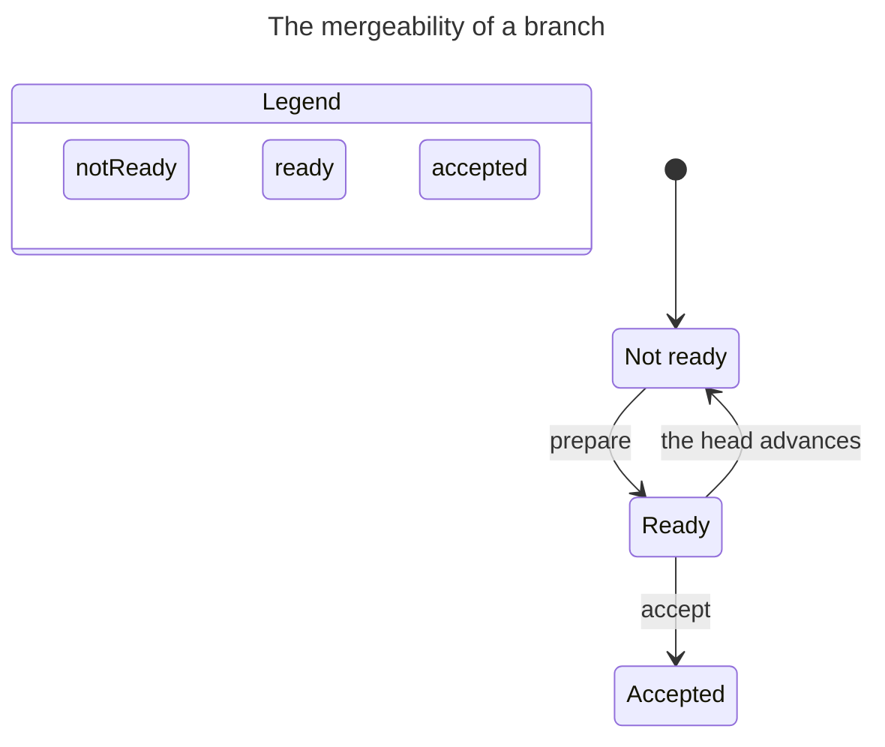

# The change model

The change model answers one question: can this branch be accepted by the trunk now? It is not the branch's own lifecycle -- `cut`, `working`, `blocked` and `parked` are a separate machine, `.agents/skills/git-discipline/references/branching.md`. It is a relation between the trunk head and the branch tip, and every value is a git predicate.

## The three states

| State | Predicate | Meaning |
|---|---|---|
| `not-ready` | the head is not an ancestor of the tip | it cannot be fast-forwarded |
| `ready` | the head is a proper ancestor of the tip | it fast-forwards |
| `accepted` | the tip is an ancestor of the head | it is on the trunk |

`stale` is not a state. It is the event "the head advanced" applied to a `ready` branch, which lands it back in `not-ready`. A worker may call the edge "re-prepare"; the mergeability value is `not-ready`.

## The transitions and the chart

The transitions are three: `not-ready -> ready` on prepare, `ready -> accepted` on accept, and `ready -> not-ready` when the head advances. `accepted` and `not-ready` are stable under a head advance.

Mergeability is derived, not stored. `ready` is `git merge-base --is-ancestor <head> <tip>`, `accepted` is the inverse, and `not-ready` is neither. The chart is a diagnostic over the repository, not a variable the system writes.

<!-- snippet: illustrative -->


## The three primitives

| Primitive | Command | What it does |
|---|---|---|
| Prepare | `prepare-rebase` | rebases the branch onto the head, resolves every conflict, and makes it fast-forwardable |
| Queue | `/merge-queue` | orders the ready branches; a stack is a contiguous run prepared on the one before it |
| Accept | `accept-fast-forward` | stages the branch at the head and advances the trunk by a compare-and-swap |

The queue is optional. A ready branch can go straight to accept, or through the queue first to see the order. The graph has both edges: prepare to accept, and prepare to the queue to accept. The queue sends a branch back to prepare when nothing is ready; accept sends a branch back to prepare when it is not ready. The queue is a view over the ready set, not a step every accept must pass.

## The accept operation

Accept is a guarded atomic transition, not a state.

- **Guard:** the branch is `ready` and it is at the head of the queue.
- **Stage:** verify it at the head in a scratch worktree: the suite and the lint gate.
- **Commit:** `update-ref refs/heads/<trunk> <tip> <head>` -- a compare-and-swap against the head that was checked.
- **Success:** the head becomes the tip.
- **Failure:** nothing is written; the head is unchanged.

`ready` makes the fast-forward total: a pointer move cannot fail for a semantic reason, because the branch resolved every conflict during prepare. The only remaining failures are environmental -- the head moved between the check and the CAS, a lock, an I/O error -- and the CAS catches exactly that.

This is the `make draft` / `make confirm` shape. Draft stages and verifies; confirm is the CAS. Verify before the CAS and there is nothing to roll back. Move first and verify after, and the rollback is the inverse CAS, which is why the old head is captured in the transaction.

## The branch work is separate

The branch has its own lifecycle: it is cut, worked, blocked or parked, and it is deleted when its trunk accepts it. That machine is not mergeability. The trunk asks only whether the branch is `ready`, and a branch that is `working` is simply not ready yet. The branch tree, its tracks and its prepare obligation are `.agents/skills/git-discipline/references/branching.md`.

## The early change

A change is made available early when another branch needs it before the milestone's branch is complete. The change is a delivery commit like any other, cut onto its own branch.

1. **Prepare.** The worker rebases the change onto the head, resolves every conflict, and makes it fast-forwardable. The change is its own delivery commit on its own branch: the branch tip is the change's commit, with its own closed handover. The remainder is a child branch.
2. **Queue (optional).** `/merge-queue` orders it; the operator can hand the ready branch straight to accept. The grain is which delivery commit is queued now: a slice cut onto its own branch, or the whole milestone's branch.
3. **Accept.** `/accept-fast-forward` CASes the head forward.
4. **Re-evaluate.** Every queued branch is re-checked. A branch no longer based on the head is `not-ready` and re-prepares.
5. **Continue.** The remainder is a child branch. It re-prepares onto the new head when the parent's prepare rewrote the shared base; when the parent was accepted without a rewrite, its tip already descends and it needs none.

A stack is a contiguous run. When the parent was accepted without a rewrite, the child's tip already descends from the new head, so its accept is a fast-forward and needs no re-prepare. When the parent's prepare rewrote the base, the child re-prepares.

## The defect flow

The defect flow is the change flow applied to a fix that more than one branch needs. A defect is reported in a handover's Findings, the operator triages it, and the fix lands once on the trunk lane as a delivery commit. Every other branch is `not-ready` against the fix until it is accepted; then each re-prepares onto the new head and replays the fix rather than writing a variant. The model is `20261105-design-open-defect_flow.md`; this section states only its relation to the change flow.

## The check

TLC reaches 11 states and 22 steps under `head <= 3`. The chart draws 3 states and 3 arrows. `TypeOK` and `NoDeadlock` hold. There is no forbidden path to mark, because the guard is the machine: an accept from `not-ready` is not a transition.

The model is the appendix. It was checked with the `statechart` skill's TLC runner; the chart above is its rendered view.

## Appendix: the model

<!-- snippet: illustrative -->
```tla
---- MODULE Mergeability ----
EXTENDS Naturals, TLC

VARIABLES state, head

vars == <<state, head>>

TypeOK ==
  /\ state \in {"notReady", "ready", "accepted"}
  /\ head \in Nat

Init ==
  /\ state = "notReady"
  /\ head = 0

Prepare ==
  /\ state = "notReady"
  /\ state' = "ready"
  /\ UNCHANGED head

Accept ==
  /\ state = "ready"
  /\ state' = "accepted"
  /\ head' = head + 1

HeadAdvances ==
  /\ head' = head + 1
  /\ state' = IF state = "ready" THEN "notReady" ELSE state

Done ==
  /\ state \in {"accepted", "notReady"}
  /\ UNCHANGED vars

Next ==
  \/ Prepare \/ Accept \/ HeadAdvances \/ Done

Spec == Init /\ [][Next]_vars

StateConstraint == head <= 3

====
```
