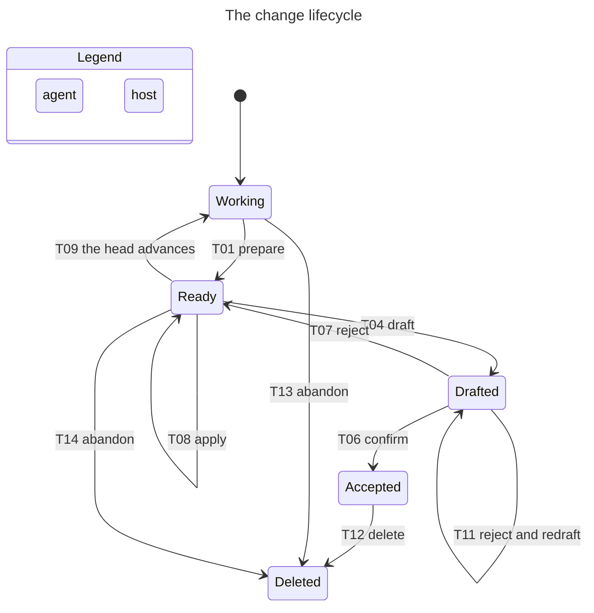

# Change pipeline domain model

The change pipeline answers one question: what is the branch's life, from its fork to its deletion? The states are the mergeability relation and the host's staging of it. It is not the iteration's progress -- that is [`workflow_statechart.md`](workflow_statechart.md)'s -- and every mergeability value is a git predicate.

The work happens in two lanes. The agent lane prepares and exports; the host lane drafts, reviews, confirms or rejects, or applies. The lanes are parallel and meet at one handoff: the bundle and the draft worktree. The host lane never reads the agent's workspace, and the agent lane never writes the trunk.

## The life

| State | Predicate | Meaning |
|---|---|---|
| `working` | the head is not an ancestor of the tip | not mergeable yet |
| `ready` | the head is a proper ancestor of the tip | mergeable; the operator's choice is the queue |
| `drafted` | a draft branch exists from the bundle | the host is staging the change |
| `accepted` | the tip is an ancestor of the head | on the trunk |
| `deleted` | the branch ref is gone | terminal |

`stale` is not a state. It is the event "the head advanced" applied to a `ready` branch, which returns it to `working`.

`blocked` and `parked` are not states either. A dependency and a decision both leave the branch `working` or `ready`; the difference is why the operator has not taken it, and the operator's choice is the queue, a view over the ready set. A branch that is ready and not chosen is `ready`.

## The iteration relation

The change flow is a peer machine to the iteration's, not a submachine of it. [`workflow_statechart.md`](workflow_statechart.md) models the session's progress; this model is the branch's life, and the two can rest at any pair of states. The iteration enters the change flow at packaging, when the branch leaves the agent's workspace, and the workflow chart points here rather than nesting these transitions.

## The two lanes

| Lane | Actor | Entry | Work | Exit |
|---|---|---|---|---|
| Agent | the coding agent | the workspace: copy (a volume seeded at start) or mount (the host worktree); full or flatten history | branch work, prepare, history-cleanup, export | the bundle and its branch point |
| Host | the operator | the bundle and the draft worktree | draft, review, confirm or reject, or apply | the trunk advanced, or the bundle rejected or applied |

The export -> draft (or export -> apply) handoff is the only meeting point.

## The delivery parameter

Delivery is a parameter of the agent lane's entry, not a second pipeline. Copy delivery seeds a volume at the session start; the host's later changes are invisible. Mount delivery materialises the host worktree; the host's changes are visible during the session. History is the second axis: full by default, flatten by opt-out. The diff pipeline is the same for both deliveries and both history modes: the bundle is the correspondence, the branch point is recorded, the host verbs are the same, no git crosses the boundary, and the apply commands carry no delivery awareness.

The delivery changes the entry and the visibility assertions, not the handoff. Copy freezes the view and keeps the session isolated; mount exposes host changes and carries the higher exposure posture. The test matrix runs the same transitions for copy and mount, full and flatten.

## The transitions

The transition table is the contract; the chart is its rendered view. `Lane` and `Actor` say who acts, `Mechanism` names the command or git operation, and `Manual` says whether an operator decision is part of the step. A blocked path is a transition that does not fire, recorded in `## The blocked paths`.

| Id | Lane | Actor | Event | Guard | From | To | Mechanism | Manual | Subject | Invariant | Test | Mutation |
|---|---|---|---|---|---|---|---|---|---|---|---|---|
| `T01` | agent | agent | prepare | the head is not an ancestor of the tip | `working` | `ready` | rebase onto the head | no | the prepare runbook | `PrepareResolvesEveryConflict` | `none: model check` | `none: model-only` |
| `T02` | agent | agent | history-cleanup | the series is not reviewable | `ready` | `ready` | `history-cleanup` | yes | the history-cleanup skill | `SeriesIsReviewable` | `none: model check` | `none: model-only` |
| `T03` | agent | agent | export | the branch is prepared | `ready` | `ready` | the package step | no | the export step | `BundleCarriesTheBranchPoint` | `none: model check` | `none: model-only` |
| `T04` | host | operator | draft | a bundle is present and forkable | `ready` | `drafted` | `make draft` | no | `scripts/workflows/draft.sh` | `MergeableRequiresForkable` | `test_draft_forks_from_branch_point_not_head` | `252` |
| `T05` | host | operator | review | a draft is present | `drafted` | `drafted` | read the diff | yes | none: operator action | `ReviewBeforeAccept` | `none: operator action` | `none: operator action` |
| `T06` | host | operator | confirm | the draft is ready and at the queue head | `drafted` | `accepted` | `make confirm` | yes | `scripts/workflows/confirm.sh` | `AtomicAccept` | `test_confirm_script_entry_merges_draft` | `52` |
| `T07` | host | operator | reject | a draft is present | `drafted` | `ready` | `make reject` | yes | `scripts/workflows/reject.sh` | `RejectRestoresTheSource` | `test_reject_returns_to_source` | `259` |
| `T08` | host | operator | apply | a bundle is present and no draft is wanted | `ready` | `ready` | `make apply` | yes | `scripts/workflows/apply.sh` | `ApplyIsDirect` | `test_apply_run_single_file_diff_reports_one` | `none: model-only` |
| `T09` | host | another accept | the head advances | a confirm moved the head | `ready` | `working` | the trunk ref update | no | none: model-only | `ReadyReturnsToWorking` | `none: model check` | `none: model-only` |
| `T10` | host | operator | operator git | the operator runs git outside the verbs | `drafted` | `drafted` | raw git | yes | none: operator action | `OperatorGitRederivesTheState` | `none: operator action` | `none: operator action` |
| `T11` | host | operator | reject and redraft | the draft is inconsistent | `drafted` | `drafted` | `make reject` then `make draft` | yes | `scripts/workflows/reject.sh` | `MistakeHasARemediation` | `test_reject_returns_to_source` | `259` |
| `T12` | host | operator | delete | the trunk accepted the branch | `accepted` | `deleted` | `git branch -d` | yes | none: operator action | `AcceptedBranchIsDeleted` | `none: operator action` | `none: operator action` |
| `T13` | host | operator | abandon | the branch is stale and not ready | `working` | `deleted` | `git branch -D` | yes | none: operator action | `AbandonedBranchIsDeleted` | `none: operator action` | `none: operator action` |
| `T14` | host | operator | abandon | the branch is stale and ready | `ready` | `deleted` | `git branch -D` | yes | none: operator action | `AbandonedBranchIsDeleted` | `none: operator action` | `none: operator action` |

## The chart

<!-- snippet: illustrative -->

## The blocked paths

| Event | Blocked when | What happens |
|---|---|---|
| prepare | the branch is already `ready` | it is a no-op; the branch is mergeable |
| confirm | the branch is `working` | it is not a transition; the branch re-prepares |
| confirm | the branch is not at the queue head | it waits; the head advances and the branch re-checks |
| draft | no bundle is present, or the package is not forkable | export or re-export first |
| apply | no bundle is present | export first |
| reject | no draft exists | there is nothing to reject; the branch is unchanged |
| operator git | no draft exists | only the branch moves; the mergeability re-derives |
| reject and redraft | the bundle is missing or malformed | the redraft refuses; the bundle is repaired first |
| delete | the branch is not `accepted` | no deletion; the branch stays until it is accepted or abandoned |

## The package

The package is the agent lane's output. Two axes carry it: **forkable** means the host can put the package's commits on a branch; **mergeable** means a clean rebase or fast-forward to the target can finish. Mergeable implies forkable; forkable does not imply mergeable.

| Form | After the agent amends | After the host rewrites | Merge guarantee |
|---|---|---|---|
| Diff from `init_sha` | not forkable | not forkable | none |
| Diff from the branch point | forkable, if the consumer forks there | may become not forkable | decided by the rebase |
| Bundle | forkable | forkable | not guaranteed |

The rules that hold are `MergeableRequiresForkable`, `BundleAlwaysForkable` and `ForkableConflictRecoverable`. The model exposes the cases that break: a diff from `init_sha` after an amend, a branch-point diff after a host rewrite, a branch-point package drafted at `HEAD`, and a bundle assumed always mergeable. The bundle carries the objects; it does not remove a textual conflict.

## The confirm sequence

The draft branch's record is present for the whole life of the branch and is removed only by branch deletion. The record is what makes the confirm recoverable: `RecordPresentDuringDraft`, `NoHungState`, `CanReturnToDraft` and `NoDeadlock` hold across the sequence.

The confirm has three failure states. `Refused` is a dirty tree or the precheck; `SwitchFailed` is the target switch; `FastForwardFailed` is the merge. Each returns the operator to the draft or the source without dropping the record, and `make reject` returns the source from any of them. The sequence is tested by `test_confirm_merges_changes`, `test_confirm_conflict_restores_the_draft_to_the_savepoint`, `test_confirm_dirty_tree_refuses_with_record`, `test_confirm_rejects_missing_record`, `test_confirm_switch_failure_keeps_draft_and_record` and `test_confirm_ff_failure_keeps_draft_and_record`.

## The primitives

The agent lane's primitives are prepare, history-cleanup and export. The host lane's verbs are `make draft`, `make confirm`, `make reject` and `make apply`; `NEW=1` and `FORCE=1` deepen an existing verb. The queue is the host's order over the ready set, not a verb.

| Primitive | Lane | Command | What it does |
|---|---|---|---|
| Prepare | agent | the prepare runbook | rebases onto the head, resolves every conflict, makes it fast-forwardable |
| History-cleanup | agent | `history-cleanup` | the operator-invoked series pass for the PR reviewer, independent of prepare |
| Export | agent | the package step | writes the bundle and its branch point |
| Draft | host | `make draft` | creates the draft worktree from the bundle |
| Confirm | host | `make confirm` | stages and verifies, then compare-and-swaps the trunk |
| Reject | host | `make reject` | discards the draft and restores the source |
| Apply | host | `make apply` | applies the bundle directly, without a draft |
| Delete | host | `git branch -d` | removes the branch after its trunk accepted it |
| Abandon | host | `git branch -D` | removes a stale branch |

## The accept operation

Accept is a guarded atomic transition, not a state. The guard is that the branch is `ready` and at the head of the queue. The trunk advances by `update-ref refs/heads/<trunk> <tip> <head>`, a compare-and-swap against the head the staged tree was verified at. If the CAS loses, nothing is written and the head is unchanged. `ready` makes the fast-forward total: the branch resolved every conflict during prepare, so the only failures left are environmental. The staging and verification steps are `make confirm`'s; this section states the contract.

## The host lane's git

The host lane's actor is the operator, who may run git outside the verbs. The model does not assume the operator is careful; it assumes the verbs are the safe path and states what to do when a raw operation goes wrong.

A competent operation is indistinguishable from a verb's mechanism: the next verb re-reads the state, and the branch's mergeability re-derives. A raw `git reset` on the branch can make it `working`; the next prepare fixes it.

A mistaken operation leaves the draft inconsistent: a wrong checkout, uncommitted edits, a half-applied bundle. The remediation is `make reject`, which discards the draft and restores the source, then `make draft`, which rebuilds the draft from the bundle. The bundle is unchanged; the branch is unchanged; only the draft is replaced. This is the host flow's repair, not the recovery of a unit's claim and not a new verb.

## The early change

A change is made available early when another branch needs it before the milestone's branch is complete. The change is its own delivery commit on its own branch, with its own closed handover; the remainder is a child branch. The operator chooses the grain -- a slice cut onto its own branch, or the whole milestone's branch -- and the queue orders it. The steps are the `prepare` runbook, the host's order and `make confirm`. When the head moves, every queued branch is re-checked: a branch no longer based on the head is `working` and re-prepares.

A stack is a contiguous run. When the parent was accepted without a rewrite, the child's tip already descends from the new head, so its accept is a fast-forward and needs no re-prepare. When the parent's prepare rewrote the base, the child re-prepares.

## The defect flow

The defect flow is the change flow applied to a fix that more than one branch needs. A defect is reported in a handover's Findings, the operator triages it, and the fix lands once on the trunk lane as a delivery commit. Every other branch is `working` against the fix until it is accepted; then each re-prepares onto the new head and replays the fix rather than writing a variant. The model is `20261105-design-open-defect_flow.md`; this section states only its relation to the change flow.

## The operations

The model is one subject; the operations that move a change through it belong to the change-pipeline skills. This table is the dispatch: each operation names one owner, and the owner's file states its procedure. `git-discipline` (`workflow/coding-agent/skills/git-discipline/SKILL.md`) keeps its local Runbooks table for a reader who enters there; this section is the pipeline's dispatch.

| Operation | Owner | Use when |
|---|---|---|
| commit and branch rules, prepare | `git-discipline` (`workflow/coding-agent/skills/git-discipline/SKILL.md`) | a commit, a branch, a fold, or a branch prepared for the trunk |
| the series rewrite | `history-cleanup` (`workflow/coding-agent/skills/git-discipline/runbooks/history-cleanup/SKILL.md`) | a feature branch's series is messy before review |
| a closed-commit correction | `/record-correction` (`workflow/coding-agent/prompts/record-correction.md`) | a correction belongs to a closed commit that is not HEAD |
| lost work | `recovery` (`workflow/coding-agent/skills/recovery/SKILL.md`) | the record and the repository disagree |
| the delivery commit | `/commit` (`workflow/coding-agent/prompts/commit.md`) | an iteration's work lands as one commit |

## The check

The chart and the table are rendered from the model's source; the TLA+ module belongs to that source and is not copied here. TLC checks the module with the `statechart` skill's runner; run it to reproduce the state and step counts. `scripts/check_change_pipeline.sh` reads the source, holds the rendered table to the rendered chart and to the mutation catalog, and `--write` regenerates the rendered chart and table.
