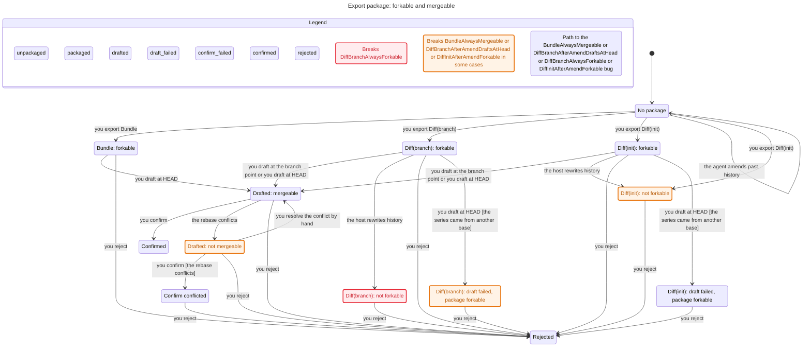
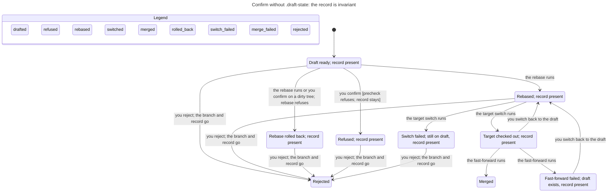

# Draft Branch Statechart

This is the model behind the 2026-11-08 entry in `docs/adr/diff_packaging.md`. It decides two things: whether an exported package can be put on a branch, and whether a draft can be accepted without losing its metadata.

Two axes carry the package. **Forkable** means the host can put the package's commits on a branch. **Mergeable** means a clean rebase or fast-forward to the target can finish. They are not independent: mergeable implies forkable, and forkable does not imply mergeable.

## The package

| Form | After the agent amends | After the host rewrites | Merge guarantee |
|---|---|---|---|
| Diff from `init_sha` | not forkable | not forkable | none |
| Diff from the branch point | forkable, if the consumer forks there | may become not forkable | decided by the rebase |
| Bundle | forkable | forkable | not guaranteed |

<!-- snippet: illustrative -->

The rules that hold are `MergeableRequiresForkable`, `BundleAlwaysForkable`, and `ForkableConflictRecoverable`. The last one is the manual-resolution assumption: a forkable draft that conflicts can always be resolved by hand into a mergeable state.

The rules that break name the cases the model is meant to expose:

| Rule | What it says | Why it breaks |
|---|---|---|
| `DiffInitAfterAmendForkable` | A diff from the recorded `init_sha` still forks after an amend. | The package base is no longer the branch point. |
| `DiffBranchAlwaysForkable` | A branch-point diff stays forkable after a host rewrite. | The host can remove the commit the package was taken at; a bundle carries it. |
| `DiffBranchAfterAmendDraftsAtHead` | A branch-point package drafts successfully after an amend. | The package is forkable, but drafting at `HEAD` uses the wrong base. |
| `BundleAlwaysMergeable` | A bundle is always mergeable. | A bundle carries the objects; it does not remove a textual conflict. |

## The draft and confirm

Without `.draft-state`, the record is branch-local config. It is present for the whole life of the branch, and it is removed only by branch deletion. There is no `Dropped .draft-state` transition.

<!-- snippet: illustrative -->

The rules that hold are `RecordPresentDuringDraft`, `NoHungState`, `CanReturnToDraft`, and `NoDeadlock`. The confirm model with `.draft-state` broke `CleanDropThenFailureHangs`, `SwitchFailureAfterDropHangs`, and `MergeFailureAfterDropHangs`; each of those paths required the dropped record.

The chart hides the no-op steps that stay in one state, including `Done`, the precheck's self-loop, and the failure probes. It also assumes the config record is written before the branch, so a branch cannot exist without it.

## What the model leaves out

- The real content of a rebase conflict. A conflict is a nondeterministic step, not a merge result.
- Patch-equivalence and the commits a rebase drops.
- `uncommitted.diff` residue and the working tree outside the clean/dirty distinction.
- The exact target tip. Mergeability is decided against a target supplied at runtime, not derived from the branch point.
- Pushed draft branches. The record is local; a pushed branch does not carry it.
- The `NEW=1` route. It is a fallback surface, not a state in this model.
