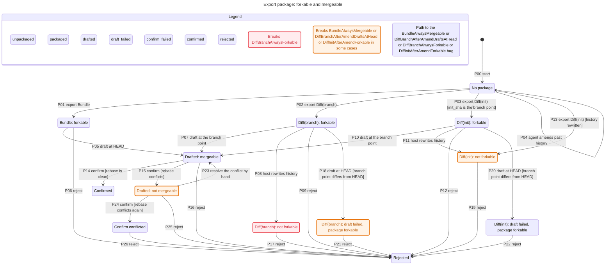
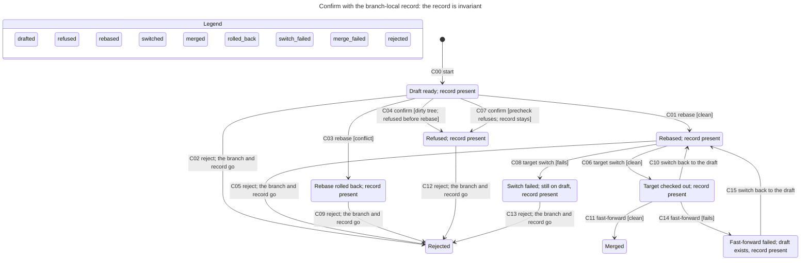

# Draft Branch Statechart

This is the model behind the 2026-11-08 entry in `docs/adr/diff_packaging.md`. It decides two things: whether an exported package can be put on a branch, and whether a draft can be accepted without losing its metadata.

Two axes carry the package. **Forkable** means the host can put the package's commits on a branch. **Mergeable** means a clean rebase or fast-forward to the target can finish. They are not independent: mergeable implies forkable, and forkable does not imply mergeable.

## The package

| Form | After the agent amends | After the host rewrites | Merge guarantee |
|---|---|---|---|
| Diff from `init_sha` | not forkable | not forkable | none |
| Diff from the branch point | forkable, if the consumer forks there | may become not forkable | decided by the rebase |
| Bundle | forkable | forkable | not guaranteed |

<!-- snippet: illustrative -->

The rules that hold are `MergeableRequiresForkable`, `BundleAlwaysForkable`, and `ForkableConflictRecoverable`. The last one is the manual-resolution assumption: a forkable draft that conflicts can always be resolved by hand into a mergeable state.

The rules that break name the cases the model is meant to expose:

| Rule | What it says | Why it breaks |
|---|---|---|
| `DiffInitAfterAmendForkable` | A diff from the recorded `init_sha` still forks after an amend. | The package base is no longer the branch point. |
| `DiffBranchAlwaysForkable` | A branch-point diff stays forkable after a host rewrite. | The host can remove the commit the package was taken at; a bundle carries it. |
| `DiffBranchAfterAmendDraftsAtHead` | A branch-point package drafts successfully after an amend. | The package is forkable, but drafting at `HEAD` uses the wrong base. |
| `BundleAlwaysMergeable` | A bundle is always mergeable. | A bundle carries the objects; it does not remove a textual conflict. |

## Transitions

The transition id is the key the tests and the mutation catalog name. `P00` is the initial transition; `P01`-`P26` are the package and draft transitions. The confirm table follows its chart under `### Confirm transitions`. `Subject` names the source file the transition contracts; a catalog row must name the same file. A `-` guard means the event alone selects the transition. The `Invariant` column names the rule the transition must preserve, or `none: reason` when the transition has no product invariant. `Tests` names a test function, or `none: reason` for an operator or host action the suite cannot drive. `Mutation` names a catalog row, or `none: reason` for a transition that is model-only.

The chart is the visual model; this table is the contract. `Id`, `From` and `To` are checked against the chart. `Event` and `Guard` are the normalized names of the transition and its condition, so they may expand the chart's shorthand; outcome text carried in a chart label is recorded in `Postcondition`. The table is the only statement of `Subject`, `Invariant`, `Precondition`, `Postcondition`, `Tests` and `Mutation`, so a link to the chart cannot replace it.

| Id | From | Event | Guard | To | Subject | Invariant | Precondition | Postcondition | Tests | Mutation |
|---|---|---|---|---|---|---|---|---|---|---|
| `P00` | `[*]` | start | - | `s0` | - | none: initial state | no package exists | no package state | none: initial state | none: initial state |
| `P01` | `s0` | export Bundle | - | `s1` | `src/libs/package_branch.sh` | `BundleAlwaysForkable` | the export succeeds | bundle written with a branch point | `test_dispatcher_creates_all_artefacts` | 255 |
| `P02` | `s0` | export Diff(branch) | the branch point is reachable | `s2` | `src/libs/package_branch.sh` | `DiffBranchAlwaysForkable` | the branch point is recorded | diff package written | `test_baseline_defaults_to_branch_point` | 256 |
| `P03` | `s0` | export Diff(init) | `init_sha` is the branch point | `s3` | `src/libs/package_branch.sh` | `MergeableRequiresForkable` | `init_sha` resolves and is reachable | package is forkable at `init_sha` | `test_baseline_explicit_override` | 257 |
| `P04` | `s0` | agent amends past history | - | `s0` | none: host action | none: host action | a package exists | the package base is stale | none: host action | none: host action |
| `P05` | `s1` | draft at HEAD | - | `s4` | `scripts/workflows/draft.sh` | `MergeableRequiresForkable` | a draft branch and record exist | draft branch is mergeable | `test_draft_forks_at_head` | 252 |
| `P06` | `s1` | reject | - | `s7` | `scripts/workflows/reject.sh` | none: terminal discard | a draft branch exists | branch and record are deleted | `test_reject_returns_to_source` | 259 |
| `P07` | `s2` | draft at the branch point | - | `s4` | `scripts/workflows/draft.sh` | `MergeableRequiresForkable` | the package branch point resolves | draft branch is mergeable | `test_draft_forks_from_branch_point_not_head` | 252 |
| `P08` | `s2` | host rewrites history | - | `s5` | `src/libs/package_branch.sh` | `DiffBranchAlwaysForkable` (breaks) | the host moves the branch point | package is not forkable | `test_moved_baseline_is_reported_and_recorded` | 261 |
| `P09` | `s2` | reject | - | `s7` | `scripts/workflows/reject.sh` | none: terminal discard | a package exists | branch and record are deleted | `test_reject_deletes_draft_branch` | 260 |
| `P10` | `s3` | draft at the branch point | - | `s4` | `scripts/workflows/draft.sh` | `MergeableRequiresForkable` | `init_sha` is still the branch point | draft branch is mergeable | `test_draft_forks_from_branch_point_not_head` | 252 |
| `P11` | `s3` | host rewrites history | - | `s6` | `src/libs/package_branch.sh` | `DiffInitAfterAmendForkable` (breaks) | `init_sha` is no longer reachable | package is not forkable | `test_moved_baseline_is_reported_and_recorded` | 261 |
| `P12` | `s3` | reject | - | `s7` | `scripts/workflows/reject.sh` | none: terminal discard | a package exists | branch and record are deleted | `test_reject_returns_to_source` | 259 |
| `P13` | `s0` | export Diff(init) | history was rewritten after `init_sha` | `s6` | `src/libs/package_branch.sh` | `DiffInitAfterAmendForkable` (breaks) | `init_sha` is no longer reachable | package is not forkable | `test_moved_baseline_is_reported_and_recorded` | 261 |
| `P14` | `s4` | confirm | the rebase is clean | `s8` | `scripts/workflows/confirm.sh` | `NoHungState` | draft branch and record are present | target fast-forwarded, draft deleted | `test_confirm_script_entry_merges_draft` | 52 |
| `P15` | `s4` | confirm | the rebase conflicts | `s11` | `scripts/workflows/confirm.sh` | `ForkableConflictRecoverable` | draft branch and record are present | draft restored to the savepoint | `test_confirm_conflict_restores_the_draft_to_the_savepoint` | 49 |
| `P16` | `s4` | reject | - | `s7` | `scripts/workflows/reject.sh` | `CanReturnToDraft` | draft branch and record are present | source branch current, draft deleted | `test_reject_returns_to_source` | 259 |
| `P17` | `s5` | reject | - | `s7` | `scripts/workflows/reject.sh` | none: terminal discard | a draft branch exists | branch and record are deleted | `test_reject_returns_to_source` | 259 |
| `P18` | `s2` | draft at HEAD | the branch point differs from HEAD | `s9` | `scripts/workflows/draft.sh` | `DiffBranchAfterAmendDraftsAtHead` (breaks) | the package is forkable at a different base | apply fails and rollback runs | `test_draft_failure_returns_to_source_branch` | 244 |
| `P19` | `s6` | reject | - | `s7` | `scripts/workflows/reject.sh` | none: terminal discard | a package exists | branch and record are deleted | `test_reject_returns_to_source` | 259 |
| `P20` | `s3` | draft at HEAD | the branch point differs from HEAD | `s10` | `scripts/workflows/draft.sh` | `DiffBranchAfterAmendDraftsAtHead` (breaks) | the package is forkable at a different base | apply fails and rollback runs | `test_draft_failure_returns_to_source_branch` | 244 |
| `P21` | `s9` | reject | - | `s7` | `scripts/workflows/reject.sh` | none: terminal discard | a failed draft exists | branch and record are deleted | `test_reject_returns_to_source` | 259 |
| `P22` | `s10` | reject | - | `s7` | `scripts/workflows/reject.sh` | none: terminal discard | a failed draft exists | branch and record are deleted | `test_reject_returns_to_source` | 259 |
| `P23` | `s11` | resolve the conflict by hand | - | `s4` | `scripts/workflows/confirm.sh` | `ForkableConflictRecoverable` | the conflict is resolved in the working tree | draft branch is mergeable | `test_confirm_conflict_restores_the_draft_to_the_savepoint` | 49 |
| `P24` | `s11` | confirm | the rebase conflicts again | `s12` | `scripts/workflows/confirm.sh` | `ForkableConflictRecoverable` | a draft branch is present | confirm conflict state | `test_confirm_conflict_recovery` | 49 |
| `P25` | `s11` | reject | - | `s7` | `scripts/workflows/reject.sh` | `CanReturnToDraft` | a conflict state is present | source branch current, draft deleted | `test_reject_returns_to_source` | 259 |
| `P26` | `s12` | reject | - | `s7` | `scripts/workflows/reject.sh` | `CanReturnToDraft` | confirm failed | source branch current, draft deleted | `test_reject_returns_to_source` | 259 |

## The draft and confirm

The record replaces `.draft-state` as branch-local config. It is present for the whole life of the branch, and it is removed only by branch deletion. There is no `Dropped .draft-state` transition.

<!-- snippet: illustrative -->

The rules that hold are `RecordPresentDuringDraft`, `NoHungState`, `CanReturnToDraft`, and `NoDeadlock`. The confirm model with `.draft-state` broke `CleanDropThenFailureHangs`, `SwitchFailureAfterDropHangs`, and `MergeFailureAfterDropHangs`; each of those paths required the dropped record.

### Confirm transitions

| Id | From | Event | Guard | To | Subject | Invariant | Precondition | Postcondition | Tests | Mutation |
|---|---|---|---|---|---|---|---|---|---|---|
| `C00` | `[*]` | start | - | `s0` | - | none: initial state | a draft branch exists | draft ready, record present | none: initial state | none: initial state |
| `C01` | `s0` | rebase | the rebase is clean | `s1` | `scripts/workflows/confirm.sh` | `RecordPresentDuringDraft`, `NoHungState` | record present | rebased, record present | `test_confirm_merges_changes` | 48 |
| `C02` | `s0` | reject | - | `s2` | `scripts/workflows/reject.sh` | `CanReturnToDraft` | record present | branch and record gone | `test_reject_returns_to_source` | 259 |
| `C03` | `s0` | rebase | the rebase conflicts | `s3` | `scripts/workflows/confirm.sh` | `NoHungState` | record present | rebase rolled back, record present | `test_confirm_conflict_restores_the_draft_to_the_savepoint` | 49 |
| `C04` | `s0` | confirm | the working tree is dirty | `s6` | `scripts/workflows/confirm.sh` | `RecordPresentDuringDraft`, `NoHungState` | record present | refused, record stays | `test_confirm_dirty_tree_refuses_with_record` | 262 |
| `C05` | `s1` | reject | - | `s2` | `scripts/workflows/reject.sh` | `CanReturnToDraft` | rebased, record present | branch and record gone | `test_reject_returns_to_source` | 259 |
| `C06` | `s1` | target switch | the switch succeeds | `s4` | `scripts/workflows/confirm.sh` | `RecordPresentDuringDraft` | rebased, record present | target checked out, record present | `test_confirm_merges_changes` | 50 |
| `C07` | `s0` | confirm | the precheck refuses | `s6` | `scripts/workflows/confirm.sh` | `RecordPresentDuringDraft`, `NoHungState` | record present | refused, record stays | `test_confirm_rejects_missing_record` | 36 |
| `C08` | `s1` | target switch | the switch fails | `s7` | `scripts/workflows/confirm.sh` | `RecordPresentDuringDraft`, `NoHungState` | rebased, record present | still on draft, record present | `test_confirm_switch_failure_keeps_draft_and_record` | 50 |
| `C09` | `s3` | reject | - | `s2` | `scripts/workflows/reject.sh` | `CanReturnToDraft` | rebase rolled back, record present | branch and record gone | `test_reject_returns_to_source` | 259 |
| `C10` | `s4` | switch back to the draft | - | `s1` | none: operator action | none: operator action | target checked out | draft checked out, record present | none: operator action | none: operator action |
| `C11` | `s4` | fast-forward | the fast-forward is clean | `s5` | `scripts/workflows/confirm.sh` | `NoHungState` | target checked out | merged, record gone | `test_confirm_merges_changes` | 51 |
| `C12` | `s6` | reject | - | `s2` | `scripts/workflows/reject.sh` | `CanReturnToDraft` | refused, record present | branch and record gone | `test_reject_returns_to_source` | 259 |
| `C13` | `s7` | reject | - | `s2` | `scripts/workflows/reject.sh` | `CanReturnToDraft` | switch failed, record present | branch and record gone | `test_reject_returns_to_source` | 259 |
| `C14` | `s4` | fast-forward | the fast-forward fails | `s8` | `scripts/workflows/confirm.sh` | `NoHungState`, `RecordPresentDuringDraft` | target checked out | draft exists, record present | `test_confirm_ff_failure_keeps_draft_and_record` | 51 |
| `C15` | `s8` | switch back to the draft | - | `s1` | none: operator action | none: operator action | fast-forward failed, record present | draft checked out, record present | none: operator action | none: operator action |

The chart hides the no-op steps that stay in one state, including `Done`, the precheck's self-loop, and the failure probes. It also assumes the config record is written before the branch, so a branch cannot exist without it.

## What the model leaves out

- The real content of a rebase conflict. A conflict is a nondeterministic step, not a merge result.
- Patch-equivalence and the commits a rebase drops.
- `uncommitted.diff` residue and the working tree outside the clean/dirty distinction.
- The exact target tip. Mergeability is decided against a target supplied at runtime, not derived from the branch point.
- Pushed draft branches. The record is local; a pushed branch does not carry it.
- The `NEW=1` route. It is a fallback surface, not a state in this model.
