# The Workflow Statechart

This is the app's workflow surface as one statechart: every state an agent rests in, every slash command that moves it, every dispatch from one prompt to another, and every maintenance check a procedure invokes. The loop's concept document, [`autonomous_agent_loop.md`](autonomous_agent_loop.md), explains why the loop is split into workflows; this document draws the whole of it, and that one point at the chart.

A node is a state the loop rests in. A gate is a node where the loop waits for the operator, and the arrow out of a gate is a decision. An arrow is a command, or the operator releasing a gate.

**A story is a path.** A behaviour this app supports is a route through these states, and writing that route down is how the behaviour is declared. `sess_oriented -> it_open -> it_scope_gate -> it_implementing -> it_acceptance_gate -> it_closed -> it_committed` is the story of one delivered unit. A declared path resolves when every id in it is a state here and every consecutive pair is an edge, which is the cheapest test this map offers of its own completeness.

**An id is the name.** A state's id is what a story cites, and it does not change when the label beside it is rewritten. Ids carry no colon, so that a path is readable in a Mermaid diagram and in a shell command alike. The labels in the diagram carry the reading; the id carries the identity.

The diagram is Mermaid 12.1.0, `stateDiagram-v2`, in the conservative subset: composite states, labelled transitions, notes, and no experimental directives. A render capability is planned and the intended target is Pele, at `https://pele.run/compatibility`; that page cannot be read from this container, so the chart is written to standard 12.1.0 syntax rather than to guessed restrictions. The version is stated so that a rendering difference has a version to blame.

## The chart

```mermaid
stateDiagram-v2
    state "Entry and orientation" as entry {
        [*] --> sess_start
        state "sess_start -- a session begins, nothing read" as sess_start
        state "sess_initialized -- the project's convention corpus is installed" as sess_initialized
        state "sess_oriented -- a check-in has run, the tree is inventoried" as sess_oriented
        state "sess_triaged -- the open rows are sorted into runnable and questioned" as sess_triaged
        sess_start --> sess_initialized : /bootstrap
        sess_start --> sess_oriented : /gm
        sess_initialized --> sess_oriented : /gm
        sess_oriented --> sess_triaged : /backlog-triage
    }

    state "Maintenance checks" as checks {
        state "chk_orientation -- the check-in skill runs" as chk_orientation
        state "chk_roadmap -- the roadmap-maintenance skill runs" as chk_roadmap
        state "chk_record -- the handover-maintenance skill runs" as chk_record
        state "chk_docs -- the doc-maintenance skill runs" as chk_docs
        state "chk_history -- the history-cleanup skill runs" as chk_history
        state "chk_corpus -- the initialize skill runs" as chk_corpus
        state "chk_close -- both record checks rerun over the rows the close wrote" as chk_close
    }

    state "Milestone grain" as milestone {
        state "ms_none -- no active milestone" as ms_none
        state "ms_active -- one milestone is active, iterations run against it" as ms_active
        state "ms_close_gate -- compaction and changelog presented, awaiting release" as ms_close_gate
        state "ms_closed -- the close is recorded, its bookkeeping commit landed" as ms_closed
        [*] --> ms_none
        ms_none --> ms_active : /milestone-start or the operator promotes a successor
        ms_active --> ms_close_gate : /milestone-close
        ms_close_gate --> ms_closed : operator releases the close
        ms_closed --> ms_active : the next milestone is promoted
        ms_closed --> ms_none : the next milestone is shaped first
    }

    state "Unit grain" as unit {
        state "it_open -- no Active handover, awaiting a directive" as it_open
        state "it_scope_gate -- scope table and acceptance criteria presented" as it_scope_gate
        state "it_implementing -- work is landing in the tree, findings appended" as it_implementing
        state "it_acceptance_gate -- the six-section summary presented, awaiting release" as it_acceptance_gate
        state "it_closed -- the handover reads Closed, the write-back applied" as it_closed
        state "it_committed -- the unit's delivery commit landed" as it_committed
        it_open --> it_scope_gate : /iter or /sidequest opens the unit
        it_scope_gate --> it_implementing : operator releases the scope
        it_implementing --> it_scope_gate : a design question reopens the scope
        it_implementing --> it_acceptance_gate : /iter reaches its pre-close summary
        it_acceptance_gate --> it_implementing : a defect is fixed rather than filed
        it_acceptance_gate --> chk_close : operator releases, /wrapup writes its rows
        chk_close --> it_closed : both reports clean, the close hands off to /commit
        it_closed --> it_committed : /commit
        it_committed --> it_open : the operator picks the next unit
    }

    state "Sidequest" as sidequest {
        state "sq_running -- the open unit is paused for operator-directed work" as sq_running
        state "sq_committed -- the sidequest's own delivery commit landed" as sq_committed
        it_implementing --> sq_running : /sidequest, when the work cannot wait
        sq_running --> sq_committed : /commit
        sq_committed --> it_implementing : the paused unit resumes
        sq_running --> it_implementing : the sidequest is ruled in scope, no run
    }

    state "Planning and publishing" as planning {
        state "plan_scoping -- the milestone is being cut into units" as plan_scoping
        state "plan_interview -- the grill-me skill probes the design" as plan_interview
        state "plan_released -- rows, stories and ADRs are written back" as plan_released
        state "doc_drafting -- a document is being written" as doc_drafting
        state "doc_published -- the document is landed" as doc_published
        ms_active --> plan_scoping : /plan or /scope
        plan_scoping --> plan_interview : the design is probed
        plan_interview --> plan_released : operator releases the scope
        plan_released --> chk_close : /wrapup writes its rows
    chk_close --> ms_active : both reports clean, no delivery commit
        ms_active --> doc_drafting : /document
        doc_drafting --> doc_published : operator releases the draft
        doc_published --> chk_close : /wrapup
    }

    state "Recovery" as recovery {
        state "rec_triage -- work is reported lost, unmergeable, or landed wrong" as rec_triage
        state "rec_merge -- the export replays onto the target" as rec_merge
        state "rec_rebase -- the stale branch ports onto the target" as rec_rebase
        state "rec_correction -- a fix folds into the closed commit" as rec_correction
        state "rec_rebuild -- the work is derived again from its record" as rec_rebuild
        [*] --> rec_triage : work is reported missing, unmergeable, or wrong
        rec_triage --> rec_merge : /merge, when it applies
        rec_triage --> rec_rebase : /rebase, when the target moved
        rec_triage --> rec_correction : /record-correction, when it landed wrong
        rec_triage --> rec_rebuild : no runbook owns the absent class
        rec_merge --> it_committed : /commit folds the corrections
        rec_rebase --> it_committed : /commit
        rec_correction --> it_closed : the target commit now carries the fix
        rec_rebuild --> it_committed : rebuilt, one commit per iteration
    }

    state "Records at rest" as records {
        state "rec_handover_active -- the unit's record is open" as rec_handover_active
        state "rec_handover_closed -- the unit's record is closed" as rec_handover_closed
        state "rec_roadmap_open -- a row is open" as rec_roadmap_open
        state "rec_roadmap_closed -- a row is closed with its outcome" as rec_roadmap_closed
        state "rec_discussion_draft -- a design or study is in draft" as rec_discussion_draft
        state "rec_discussion_settled -- the record is settled or closed" as rec_discussion_settled
        state "rec_adr_accepted -- a decision record is current" as rec_adr_accepted
        it_scope_gate --> rec_handover_active : the handover is opened
        rec_handover_active --> rec_handover_closed : /commit lands the status flip
        plan_released --> rec_roadmap_open : a row is filed
        it_closed --> rec_roadmap_closed : the write-back closes the row
        plan_interview --> rec_discussion_draft : a design or study opens
        it_closed --> rec_discussion_settled : a record whose work landed closes
        plan_released --> rec_adr_accepted : a settled decision gets an ADR
        rec_handover_closed --> sess_oriented : the next iteration reads the prior record
        rec_roadmap_open --> it_open : the operator picks the row
        rec_roadmap_open --> plan_scoping : the milestone's rows are read
        rec_roadmap_closed --> chk_roadmap : the closed rows are the compaction's input
        rec_discussion_draft --> it_scope_gate : the design record is the scope's input
        rec_discussion_settled --> it_scope_gate : the settled record is the design
        rec_adr_accepted --> it_implementing : the decision constrains the work
    }

    sess_oriented --> it_open : the operator names a roadmap row
    sess_triaged --> it_open : a runnable row is picked
    it_open --> ms_active : no milestone is active and the row needs one

    sess_oriented --> chk_orientation : /gm runs the check-in skill
    ms_active --> chk_roadmap : /milestone-close runs the compaction pass
    it_implementing --> chk_roadmap : /iter runs the roadmap record check
    it_implementing --> chk_record : /iter runs the handover record check
    it_implementing --> chk_docs : /iter's information-gathering pass
    doc_drafting --> chk_docs : /document reads the diagnostic register
    sess_initialized --> chk_corpus : /bootstrap installs the corpus
    rec_rebase --> chk_history : a series inverted before review

    chk_corpus --> sess_oriented : the corpus is installed
    chk_orientation --> sess_oriented : the report is applied
    chk_roadmap --> chk_record : the two reports meet at one gate
    chk_record --> it_acceptance_gate : the findings queue carries the report
    chk_docs --> doc_published : the report is applied
    chk_history --> rec_merge : the series is rewritten, then replayed
```

## States

| Id | Region | The state it names |
|---|---|---|
| `sess_start` | entry | a session begins and nothing has been read |
| `sess_initialized` | entry | the project's convention corpus is installed |
| `sess_oriented` | entry | a check-in has run and the tree is inventoried |
| `sess_triaged` | entry | the open rows are sorted into runnable and questioned |
| `chk_orientation` | checks | the `check-in` skill runs |
| `chk_roadmap` | checks | the `roadmap-maintenance` skill runs |
| `chk_record` | checks | the `handover-maintenance` skill runs |
| `chk_docs` | checks | the `doc-maintenance` skill runs |
| `chk_history` | checks | the `history-cleanup` skill runs |
| `chk_corpus` | checks | the `initialize` skill runs |
| `chk_close` | checks | both record checks rerun over the rows the close wrote |
| `ms_none` | milestone | no milestone is active |
| `ms_active` | milestone | one milestone is active; iterations run against it |
| `ms_close_gate` | milestone | compaction and changelog presented, awaiting release |
| `ms_closed` | milestone | the close is recorded and its bookkeeping commit landed |
| `it_open` | unit | no `Active` handover; awaiting a directive |
| `it_scope_gate` | unit | scope table and acceptance criteria presented |
| `it_implementing` | unit | work is landing in the tree and findings are appended |
| `it_acceptance_gate` | unit | the six-section summary is presented, awaiting release |
| `it_closed` | unit | the handover reads `Closed` and the write-back is applied |
| `it_committed` | unit | the unit's delivery commit landed |
| `sq_running` | sidequest | the open unit is paused for operator-directed work |
| `sq_committed` | sidequest | the sidequest's own delivery commit landed |
| `plan_scoping` | planning | the milestone is being cut into units |
| `plan_interview` | planning | the `grill-me` skill is probing the design |
| `plan_released` | planning | rows, stories and ADRs are written back |
| `doc_drafting` | planning | a document is being written |
| `doc_published` | planning | the document is landed |
| `rec_triage` | recovery | work is reported lost, unmergeable, or landed wrong |
| `rec_merge` | recovery | the export replays onto the target |
| `rec_rebase` | recovery | the stale branch ports onto the target |
| `rec_correction` | recovery | a fix folds into the closed commit |
| `rec_rebuild` | recovery | the work is derived again from its record |
| `rec_handover_active` | records | the unit's record is open |
| `rec_handover_closed` | records | the unit's record is closed |
| `rec_roadmap_open` | records | a row is open |
| `rec_roadmap_closed` | records | a row is closed with its outcome |
| `rec_discussion_draft` | records | a design or study is in draft |
| `rec_discussion_settled` | records | a record is settled or closed |
| `rec_adr_accepted` | records | a decision record is current |

## Commands

Every prompt the tree carries is an event here, and the command table is held to `workflow/coding-agent/prompts/` by the check in the next section.

| Command | Fires from | Leaves the agent in | Dispatches |
|---|---|---|---|
| `/bootstrap` | `sess_start` | `sess_initialized` | `initialize` |
| `/gm` | `sess_start`, `sess_initialized` | `sess_oriented` | `check-in`, `roadmap-maintenance`, `handover-maintenance` |
| `/backlog-triage` | `sess_oriented` | `sess_triaged` | none |
| `/milestone-start` | `ms_none` | `ms_active` | none |
| `/plan` | `ms_active` | `plan_released` | `grill-me`, `/wrapup` |
| `/scope` | `ms_active` | `plan_released` | `/wrapup`, `/commit` |
| `/document` | `ms_active` | `doc_published` | `doc-maintenance`, `grill-me`, `/wrapup`, `/commit` |
| `/iter` | `it_open` | `it_committed` | `roadmap-maintenance`, `handover-maintenance`, `doc-maintenance`, `/wrapup`, `/commit` |
| `/sidequest` | `it_implementing` | `sq_committed` | `/iter`'s orient steps, `/commit` |
| `/milestone-close` | `ms_active` | `ms_closed` | `roadmap-maintenance`; its own bookkeeping commit, not `/commit` |
| `/merge` | `rec_triage` | `it_committed` | `/commit` |
| `/rebase` | `rec_triage` | `it_committed` | `history-cleanup`, `/commit` |
| `/record-correction` | `rec_triage` | `it_closed` | `/rebase` when the fold needs a port |
| `/read-back` | `rec_triage` | `rec_triage` | none |
| `/wrapup` | a released gate | `chk_close` | `roadmap-maintenance`, `handover-maintenance`, `/commit` |
| `/commit` | a closed unit | `it_committed` | none |
| `/package-eval-snapshot` | any settled state | the same state | `eval` |

`/auto` and `/goal` are reserved by the ADR for M4 and drive no transition here. A draft is not a command: a prompt that exists only under `.agents/drafts/` appears in no row of this table and in no node of the chart.

## Stories

Each row is a behaviour, written as a path. A path resolves when every id is a state above and every consecutive pair is an edge in the diagram.

| Story | Path |
|---|---|
| One delivered unit | `sess_oriented -> it_open -> it_scope_gate -> it_implementing -> it_acceptance_gate -> chk_close -> it_closed -> it_committed` |
| The next unit after a commit | `it_committed -> it_open -> it_scope_gate` |
| A milestone closes and the next promotes | `ms_active -> ms_close_gate -> ms_closed -> ms_active` |
| A milestone closes and the next is shaped | `ms_active -> ms_close_gate -> ms_closed -> ms_none -> ms_active` |
| A sidequest interrupts an open unit | `it_implementing -> sq_running -> sq_committed -> it_implementing` |
| Planning a milestone | `ms_active -> plan_scoping -> plan_interview -> plan_released -> chk_close -> ms_active` |
| Publishing a document | `ms_active -> doc_drafting -> doc_published -> chk_close -> it_closed -> it_committed` |
| The close checks the rows it wrote | `it_acceptance_gate -> chk_close -> it_closed` |
| Recovering an unportable export | `rec_triage -> rec_rebase -> it_committed -> it_open` |
| A project bootstrapped and oriented | `sess_start -> sess_initialized -> sess_oriented -> it_open` |
| The record checks before a release | `it_implementing -> chk_roadmap -> chk_record -> it_acceptance_gate` |

## Checks

Each check is a query a reader makes on the chart and the defect the query finds. They are read by hand today; a script is the next rung of the maturity chain, and the working document in the session output records what such a script would read.

| Check | The query | The defect it finds |
|---|---|---|
| Unreachable state | every state has an inbound path from a `[*]` and from a region's entry | a command or check no path reaches |
| No dispatcher | every `chk_*` state has at least one incoming edge labelled with a command | a maintenance skill nothing runs |
| Unchecked record write | every edge whose effect writes a `rec_*` state is followed, on every path to a gate, by a `chk_*` state or a gate the chart marks as checked | maintenance work with no check on its path |
| Dangling dispatch | every dispatch named in the command table resolves to a file under `prompts/`, `skills/` or the reference layer | a dispatch to something that does not exist |
| Dead end | every state outside the records region has an outbound edge; a `rec_*` state is terminal by design | a command that strands the agent |
| Unsatisfied entry | a command's input contract holds in the state it fires from: `/commit` requires an open handover, `/milestone-close` requires an active milestone | a runbook's precondition the chart violates |
| Guard collision | no state has two outbound edges on one event whose guards can both hold | an ambiguous transition |
| Orphan record | every `rec_*` state has an inbound write edge and an outbound read edge | a record kept and never consulted |
| Path resolution | every path in `## Stories` resolves id by id: each id is a declared state, and each consecutive pair is an edge | a story the map does not support |
| Command coverage | every prompt file under `workflow/coding-agent/prompts/` appears in `## Commands` | a command the map does not know |

## Gaps

- **Story coverage.** The stories cover the main paths, not every edge: the recovery and records edges are drawn and no story routes them. The query is the edge set minus the pairs the stories use.
- **`/auto` and `/goal`.** Reserved for M4 by `docs/adr/coding_agent_loop_workflow.md`, which is repository-only and cannot be linked from here; no transition, and no node.
- **`history-cleanup`.** Reached from the `git-discipline` convention's runbook table rather than from a prompt, so its single incoming edge above comes from `/rebase`. A maintenance skill dispatched by a convention rather than a command is the one member of the set with no command edge of its own.
- **The render capability.** Not built. The chart targets Mermaid 12.1.0, and the intended render target, Pele's compatibility page, could not be read from this container.
